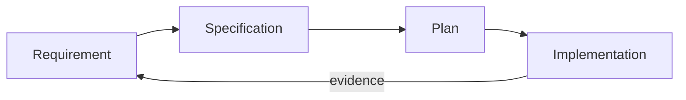
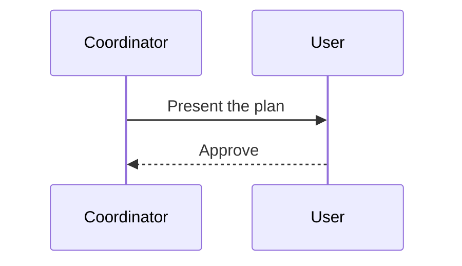
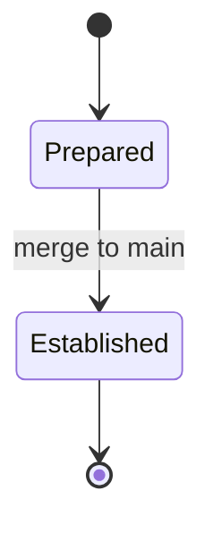
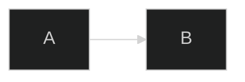
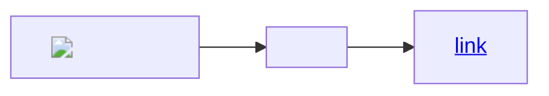
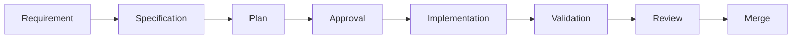

# Diagrams

Fixture document for the diagram rendering contract.

## Flowchart



## Sequence



## State



## Invalid

```mermaid
flowchart LR
  A --> 
  this is not valid ((((
```

## Directive



## Label with markup



## Wide



## Code

```js
const kept = 'code panel';
```
