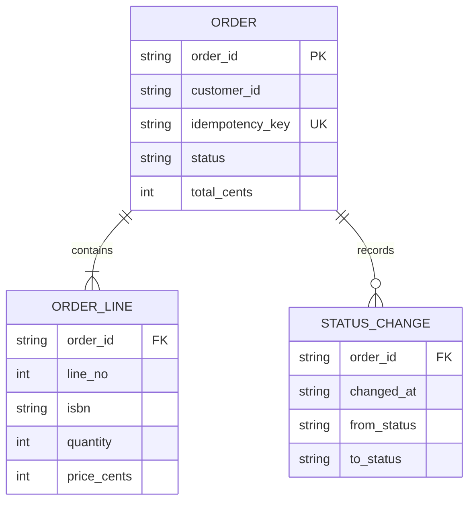
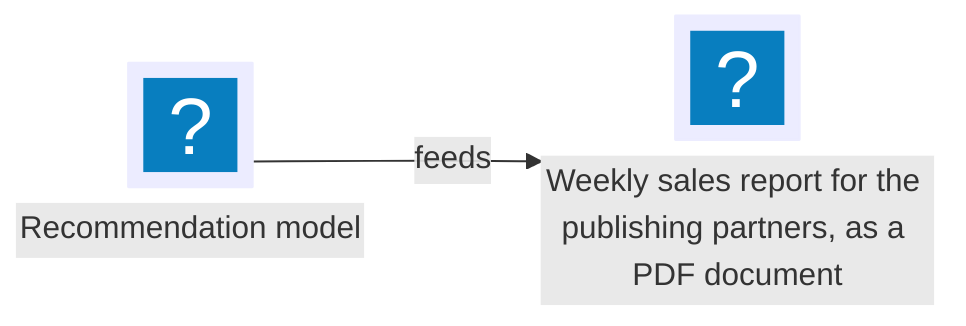

# Order data

This document states the entities of the order data in the orders table. The [Bookshop system overview](../../platform/specifications/system-overview.md) shows the orders table in the bookshop.

## Entities

Each line of the view below is a relationship with its cardinality.

| Entity | Fields | Rule |
| --- | --- | --- |
| `ORDER` | `order_id` (key), `customer_id`, `idempotency_key` (unique), `status`, `total_cents` | — |
| `ORDER_LINE` | `order_id` (reference to `ORDER`), `line_no`, `isbn`, `quantity`, `price_cents` | An order has one or more lines. |
| `STATUS_CHANGE` | `order_id` (reference to `ORDER`), `changed_at`, `from_status`, `to_status` | An order has zero or more status changes. |

Source: ordering:specifications/order-data.md#entities; derived one entity per table row, one attribute per field and one line per stated rule; current snapshot.

## Reader fallback sample

The sample below shows two cases that every reader draws the same way: an icon name outside the supported set, and a long label that wraps. The arrow shows runtime interaction: the source feeds the target.

Illustrative: an icon outside the set and a label longer than 60 characters; the order data facts do not include this pair.
