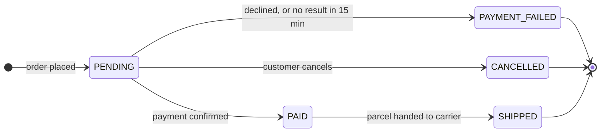

# Order lifecycle

This document states the statuses of an order and the events that change them. The [Bookshop system overview](../../platform/specifications/system-overview.md) shows the parts of the bookshop that send these events.

## States and events

Each arrow of the view below is an event that changes the status of an order.

| Status | Event | Next status |
| --- | --- | --- |
| — | order placed | `PENDING` |
| `PENDING` | payment confirmed | `PAID` |
| `PENDING` | payment declined, or no result in 15 minutes | `PAYMENT_FAILED` |
| `PENDING` | customer cancels | `CANCELLED` |
| `PAID` | parcel handed to carrier | `SHIPPED` |

`PAYMENT_FAILED`, `CANCELLED` and `SHIPPED` are final statuses.

Source: ordering:specifications/order-lifecycle.md#states-and-events; derived one state per status and one transition per row of the table; current snapshot.

Stale: payments:specifications/payment-worker.md changed; recheck pending.
