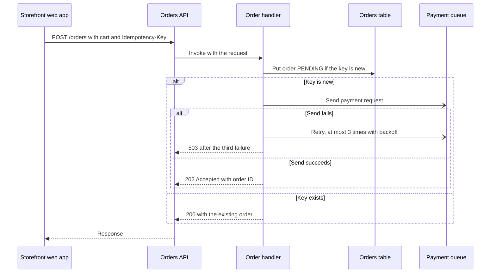
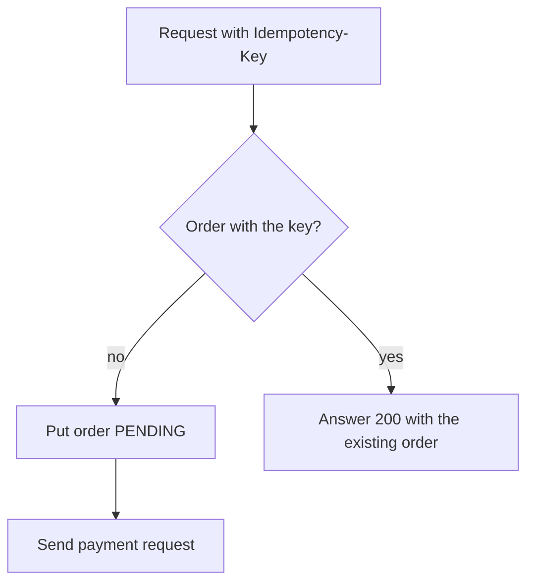

# Orders API

This document is the contract of the Orders API, the order handler and the orders table. The [Bookshop system overview](../../platform/specifications/system-overview.md) shows these parts in the bookshop. The flow `ordering:place-order` is the authority for the order journey.

## Create an order

This view shows the part of the flow `ordering:place-order` that `ordering` owns; the flow record continues with the payment worker of `payments`. Arrows are messages from the sender to the receiver; a dashed arrow is a response, and an open arrowhead is an asynchronous send. The facts are:

1. The storefront web app sends `POST /orders` with the cart and an `Idempotency-Key` header to the Orders API.
2. The Orders API invokes the order handler with the request.
3. The order handler puts the order with status `PENDING` into the orders table only when no order has the key.
4. When the key is new, the handler sends a payment request to the payment queue.
5. When the send succeeds, the handler answers `202 Accepted` with the order ID.
6. When the send fails, the handler retries at most three times with backoff. After the third failure it answers `503`, and the order stays `PENDING`.
7. When the key exists, the handler answers `200` with the existing order.
8. The Orders API returns the answer to the storefront web app.

Source: ordering:specifications/orders-api.md#create-an-order; ordering:place-order; derived one participant per named party and one message per stated step; current snapshot.

## Idempotency check

The view shows the decision that the order handler makes for each request. Each arrow is the next step, with its condition.

The handler keeps the key in the field `idempotency_key` of the order. Two requests with the same key therefore create one order.

## Order emails

The order handler sends an order email through the email service when it accepts an order. In the environment `production`, the email service is SES.

## Resources

In the environment `production`, the Orders API is the HTTP API `orders-api` of API Gateway. The order handler is the Lambda function `order-handler`. The orders table is the DynamoDB table `orders`.
