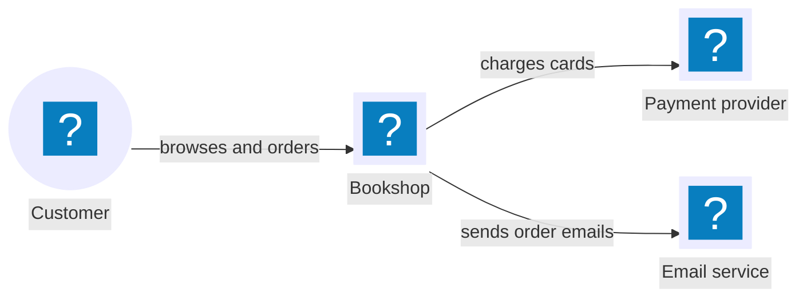
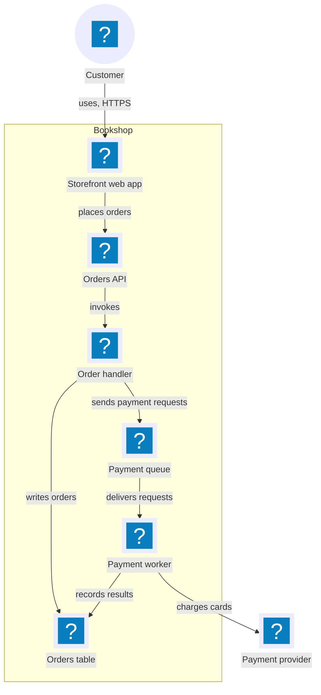
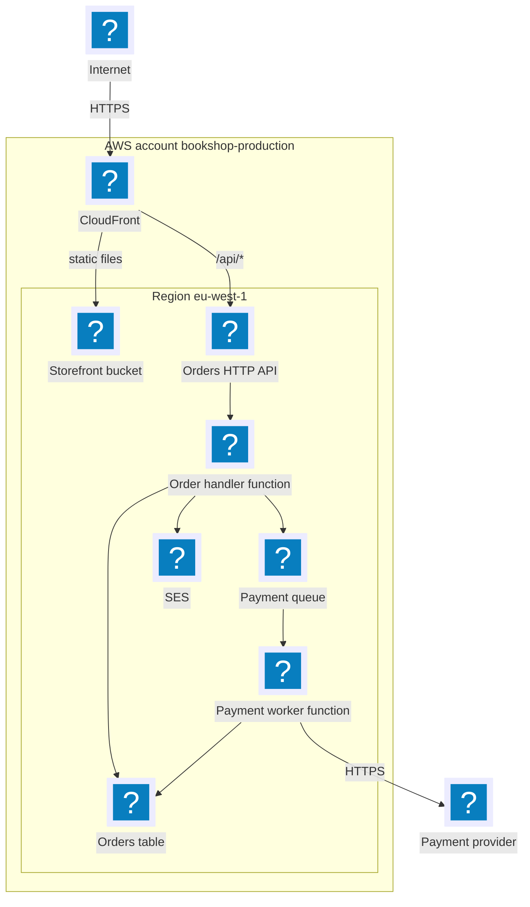

# Bookshop system overview

This document holds the system views of the online bookshop on AWS. Each view has an introduction, an accessible title and description, and a source line. An owner table follows each view. The table names the owning artifact of each element and links to its knowledge.

## Selected views

| View | Decision | Reason |
| --- | --- | --- |
| System context | Selected, as the overview | People and other systems use the bookshop. |
| Logical architecture | Selected, as the detail of the bookshop node | The bookshop has six applications and data stores. |
| Deployment overview | Selected, for the environment `production` | Placement on managed AWS services affects the API and queue contracts. |
| Network and trust boundaries | Omitted | The payment provider stores the card data. The knowledge states one trust zone. |
| Critical end-to-end flow | Omitted | The flow record `ordering:place-order` holds the journey. |
| Resilience and disaster recovery | Omitted | The knowledge states no recovery objective. |
| Delivery pipeline | Omitted | The knowledge states no pipeline. |

## System context

The view shows the people and systems around the bookshop. It is the overview; the logical architecture below is the detail of the Bookshop node. Arrows show runtime interaction: the source uses or calls the target. The facts are:

1. Customers browse books and place orders in the bookshop with a web browser.
2. The bookshop charges cards through an external payment provider.
3. The bookshop sends order emails through an email service.

Source: platform:specifications/system-overview.md#system-context; derived one node per named actor or system and one arrow per stated interaction; current snapshot.

| Element | Owning artifact | Knowledge |
| --- | --- | --- |
| Customer | external | — |
| Bookshop | `platform` | [Logical architecture](#logical-architecture) |
| Payment provider | external | [Payment worker](../../payments/specifications/payment-worker.md) |
| Email service | external | [Orders API](../../ordering/specifications/orders-api.md) |

## Logical architecture

The view shows the applications and data stores inside the bookshop and how they communicate. It is the detail of the Bookshop node of the system context. Arrows show runtime interaction. The flow `ordering:place-order` is the authority for the order journey; this view shows only the containers and their interactions. The facts are:

1. The customer uses the storefront web app over HTTPS.
2. The storefront web app places orders through the Orders API.
3. The Orders API invokes the order handler.
4. The order handler writes orders to the orders table.
5. The order handler sends payment requests to the payment queue.
6. The payment queue delivers each request to the payment worker.
7. The payment worker charges the card through the payment provider.
8. The payment worker records the payment result in the orders table.

Source: platform:specifications/system-overview.md#logical-architecture, the detail of the system context; storefront:specifications/web-app.md; ordering:specifications/orders-api.md; payments:specifications/payment-worker.md; derived one node per named container and one arrow per stated interaction; current snapshot.

| Element | Owning artifact | Knowledge |
| --- | --- | --- |
| Storefront web app | `storefront` | [Storefront web app](../../storefront/specifications/web-app.md) |
| Orders API, Order handler, Orders table | `ordering` | [Orders API](../../ordering/specifications/orders-api.md), [Order data](../../ordering/specifications/order-data.md) |
| Payment queue, Payment worker | `payments` | [Payment worker](../../payments/specifications/payment-worker.md) |
| Customer, Payment provider | external | — |

## Deployment overview: production

The view places the software of the environment `production` on AWS. A box means that the element runs or is stored in it. Arrows show network traffic from the caller to the callee; a label names the protocol or the path. The facts are:

1. The environment runs in the AWS account `bookshop-production`. CloudFront is a global service of the account; every other resource is in the region `eu-west-1`.
2. Clients on the internet reach the CloudFront distribution over HTTPS.
3. CloudFront serves the static files of the storefront from the S3 bucket `storefront`.
4. CloudFront forwards the path `/api/*` to the HTTP API `orders-api` of API Gateway.
5. `orders-api` invokes the Lambda function `order-handler`.
6. `order-handler` writes the DynamoDB table `orders`, sends messages to the SQS queue `payment-requests` and sends email through SES.
7. The Lambda function `payment-worker` reads `payment-requests`, calls the payment provider over HTTPS and writes `orders`.

Source: platform:specifications/system-overview.md#deployment-overview-production; derived one node per named resource, one box per account or region and one arrow per stated route; current snapshot.

| Element | Resource | Owning artifact | Knowledge |
| --- | --- | --- | --- |
| CloudFront, Storefront bucket | distribution, bucket `storefront` | `storefront` | [Storefront web app](../../storefront/specifications/web-app.md) |
| Orders HTTP API, Order handler function, Orders table, SES | `orders-api`, `order-handler`, table `orders`, SES | `ordering` | [Orders API](../../ordering/specifications/orders-api.md) |
| Payment queue, Payment worker function | queue `payment-requests`, `payment-worker` | `payments` | [Payment worker](../../payments/specifications/payment-worker.md) |
| AWS account, region | `bookshop-production`, `eu-west-1` | `platform` | [Deployment overview](#deployment-overview-production) |
| Internet, Payment provider | external | external | — |
