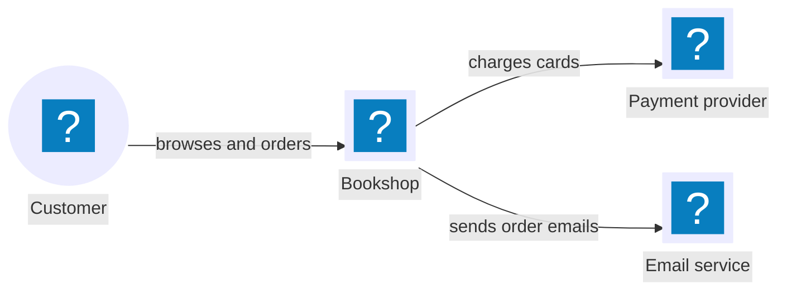
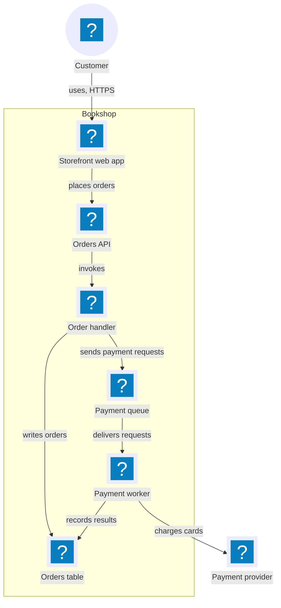
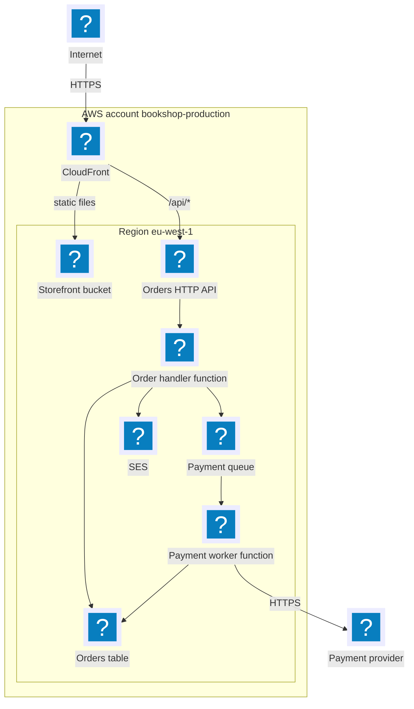
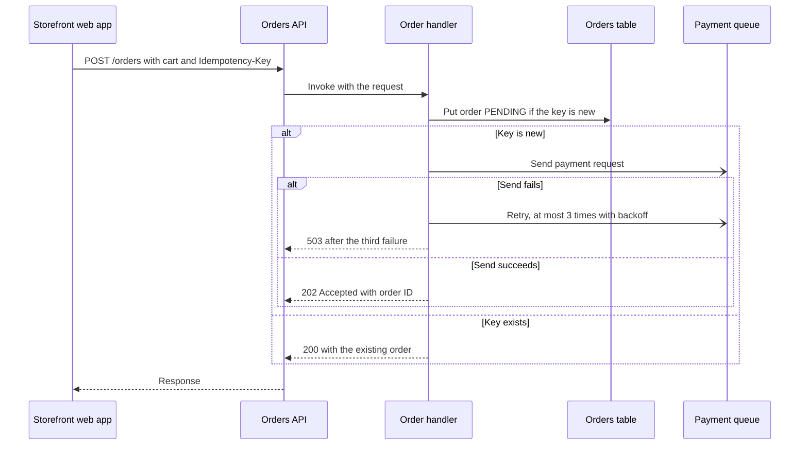
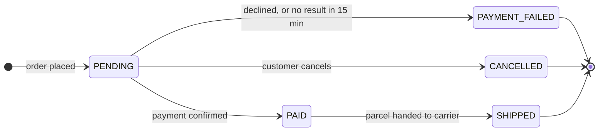
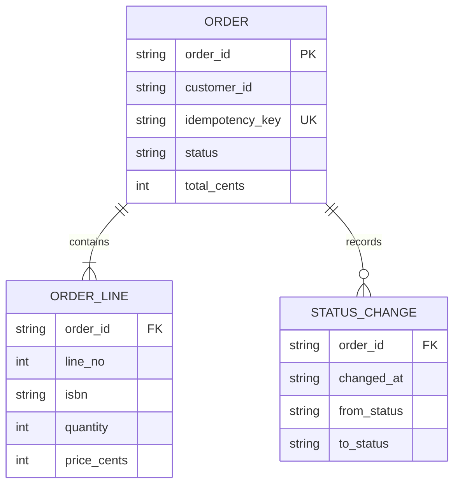
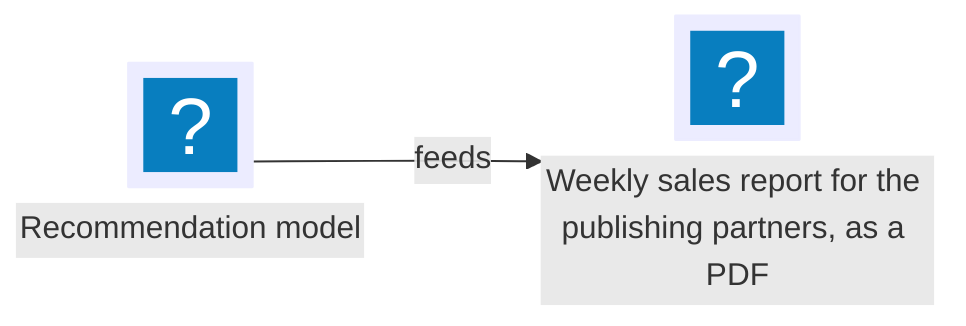

# Diagram Scopes Example

This example applies the scopes, the selection matrix, the owner tables and the icons of the [visual representation guide](visual-representations.md) to an invented online bookshop on AWS. The bookshop, its repository, its artifacts and its facts are invented for this page. The page names no real account, person or file. Logical identities such as `ordering:specifications/orders-api.md` name documents of the invented repository.

The page first states the facts. Each view is then derived from those facts, with an introduction, an accessible title and description, and a source line.

## The Invented Repository

The bookshop knowledge has four artifacts.

| Artifact | Owns |
| --- | --- |
| `platform` | The system views in `specifications/system-overview.md` |
| `storefront` | The storefront web app, in `specifications/web-app.md` |
| `ordering` | The Orders API, the order handler and the orders table in `specifications/orders-api.md`; the order lifecycle in `specifications/order-lifecycle.md`; the order data in `specifications/order-data.md`; the flow `ordering:place-order` |
| `payments` | The payment queue, the payment worker and the payment provider integration, in `specifications/payment-worker.md` |

The README of `platform` says that it owns the system views of the bookshop. Its system view document starts with this front matter:

```yaml
---
system_view: true
---
```

The documents of `ordering` link once, in their introduction, to `platform:specifications/system-overview.md`. In the repository, every knowledge cell of an owner table below is a relative link to that document.

## Selected Views

The selection matrix gives these decisions for the bookshop.

| View | Scope | Decision | Reason |
| --- | --- | --- | --- |
| System context | System | Selected, as the overview | People and other systems use the bookshop. |
| Logical architecture | System | Selected, as the detail of the bookshop node | The bookshop has six applications and data stores. |
| Deployment overview | System | Selected, for the environment `production` | Placement on managed AWS services affects the API and queue contracts. |
| Network and trust boundaries | System | Omitted | The payment provider stores the card data; the bookshop stores no sensitive payment data, and the knowledge states one trust zone. |
| Critical end-to-end flow | System | Omitted; the reader shows `ordering:place-order` from its record | A flow record already holds the journey. |
| Resilience and disaster recovery | System | Omitted | The knowledge states no recovery objective. |
| Delivery pipeline | System | Omitted | The knowledge states no pipeline. |
| Sequence | Artifact `ordering` | Selected | Order creation has five participants, an idempotency check, asynchronous work and a retry. |
| State | Artifact `ordering` | Selected | An order has five statuses and conditional transitions. |
| Data model | Artifact `ordering` | Selected | The order data has three entities with keys and cardinality. |
| Flowchart, component, deployment detail, security or data flow | Artifact `ordering` | Omitted | The text and the views above already explain the artifact. |

## System Views

These views are in `platform:specifications/system-overview.md`.

### System Context

The view shows the people and systems around the bookshop. It is the overview; the logical architecture below is the detail of the Bookshop node. Arrows show runtime interaction: the source uses or calls the target. The facts are:

1. Customers browse books and place orders in the bookshop with a web browser.
2. The bookshop charges cards through an external payment provider.
3. The bookshop sends order emails through an email service.



Source: platform:specifications/system-overview.md#system-context; derived one node per named actor or system and one arrow per stated interaction; current snapshot.

| Element | Owning artifact | Knowledge |
| --- | --- | --- |
| Customer | external | — |
| Bookshop | `platform` | `platform:specifications/system-overview.md#logical-architecture` |
| Payment provider | external | `payments:specifications/payment-worker.md` |
| Email service | external | `ordering:specifications/orders-api.md` |

### Logical Architecture

The view shows the applications and data stores inside the bookshop and how they communicate. It is the detail of the Bookshop node of the system context. Arrows show runtime interaction. The flow `ordering:place-order` is the authority for the order journey; this view shows only the containers and their interactions. The facts are:

1. The customer uses the storefront web app over HTTPS.
2. The storefront web app places orders through the Orders API.
3. The Orders API invokes the order handler.
4. The order handler writes orders to the orders table.
5. The order handler sends payment requests to the payment queue.
6. The payment queue delivers each request to the payment worker.
7. The payment worker charges the card through the payment provider.
8. The payment worker records the payment result in the orders table.



Source: platform:specifications/system-overview.md#logical-architecture, the detail of the system context; storefront:specifications/web-app.md; ordering:specifications/orders-api.md; payments:specifications/payment-worker.md; derived one node per named container and one arrow per stated interaction; current snapshot.

| Element | Owning artifact | Knowledge |
| --- | --- | --- |
| Storefront web app | `storefront` | `storefront:specifications/web-app.md` |
| Orders API, Order handler, Orders table | `ordering` | `ordering:specifications/orders-api.md`, `ordering:specifications/order-data.md` |
| Payment queue, Payment worker | `payments` | `payments:specifications/payment-worker.md` |
| Customer, Payment provider | external | — |

### Deployment Overview: Production

The view places the software of the environment `production` on AWS. A box means that the element runs or is stored in it. Arrows show network traffic from the caller to the callee; a label names the protocol or the path. The facts are:

1. The environment runs in the AWS account `bookshop-production`. CloudFront is a global service of the account; every other resource is in the region `eu-west-1`.
2. Clients on the internet reach the CloudFront distribution over HTTPS.
3. CloudFront serves the static files of the storefront from the S3 bucket `storefront`.
4. CloudFront forwards the path `/api/*` to the HTTP API `orders-api` of API Gateway.
5. `orders-api` invokes the Lambda function `order-handler`.
6. `order-handler` writes the DynamoDB table `orders`, sends messages to the SQS queue `payment-requests` and sends email through SES.
7. The Lambda function `payment-worker` reads `payment-requests`, calls the payment provider over HTTPS and writes `orders`.



Source: platform:specifications/system-overview.md#deployment-overview-production; derived one node per named resource, one box per account or region and one arrow per stated route; current snapshot.

| Element | Resource | Owning artifact | Knowledge |
| --- | --- | --- | --- |
| CloudFront, Storefront bucket | distribution, bucket `storefront` | `storefront` | `storefront:specifications/web-app.md` |
| Orders HTTP API, Order handler function, Orders table, SES | `orders-api`, `order-handler`, table `orders`, SES | `ordering` | `ordering:specifications/orders-api.md` |
| Payment queue, Payment worker function | queue `payment-requests`, `payment-worker` | `payments` | `payments:specifications/payment-worker.md` |
| AWS account, region | `bookshop-production`, `eu-west-1` | `platform` | `platform:specifications/system-overview.md` |
| Internet, Payment provider | external | external | — |

## Artifact Views of Ordering

These views belong to `ordering`. Each document links to the system overview in its introduction, and its views show only what `ordering` owns.

### Place an Order

This view is in `ordering:specifications/orders-api.md`, section Create an order. It shows the part of the flow `ordering:place-order` that `ordering` owns; the flow record continues with the payment worker of `payments`. Arrows are messages from the sender to the receiver; a dashed arrow is a response, and an open arrowhead is an asynchronous send. The facts are:

1. The storefront web app sends `POST /orders` with the cart and an `Idempotency-Key` header to the Orders API.
2. The Orders API invokes the order handler with the request.
3. The order handler puts the order with status `PENDING` into the orders table only when no order has the key.
4. When the key is new, the handler sends a payment request to the payment queue.
5. When the send succeeds, the handler answers `202 Accepted` with the order ID.
6. When the send fails, the handler retries at most three times with backoff. After the third failure it answers `503`, and the order stays `PENDING`.
7. When the key exists, the handler answers `200` with the existing order.
8. The Orders API returns the answer to the storefront web app.



Source: ordering:specifications/orders-api.md#create-an-order; ordering:place-order; derived one participant per named party and one message per stated step; current snapshot.

### Order Lifecycle

This view is in `ordering:specifications/order-lifecycle.md`, section States and events. Each arrow is an event that changes the status of an order.

| Status | Event | Next status |
| --- | --- | --- |
| — | order placed | `PENDING` |
| `PENDING` | payment confirmed | `PAID` |
| `PENDING` | payment declined, or no result in 15 minutes | `PAYMENT_FAILED` |
| `PENDING` | customer cancels | `CANCELLED` |
| `PAID` | parcel handed to carrier | `SHIPPED` |

`PAYMENT_FAILED`, `CANCELLED` and `SHIPPED` are final statuses.



Source: ordering:specifications/order-lifecycle.md#states-and-events; derived one state per status and one transition per row of the table; current snapshot.

### Order Data Model

This view is in `ordering:specifications/order-data.md`, section Entities. Each line is a relationship with its cardinality.

| Entity | Fields | Rule |
| --- | --- | --- |
| `ORDER` | `order_id` (key), `customer_id`, `idempotency_key` (unique), `status`, `total_cents` | — |
| `ORDER_LINE` | `order_id` (reference to `ORDER`), `line_no`, `isbn`, `quantity`, `price_cents` | An order has one or more lines. |
| `STATUS_CHANGE` | `order_id` (reference to `ORDER`), `changed_at`, `from_status`, `to_status` | An order has zero or more status changes. |



Source: ordering:specifications/order-data.md#entities; derived one entity per table row, one attribute per field and one line per stated rule; current snapshot.

## Reader Fallback

Artifact Plane draws the icons of the supported set. GitHub and the documentation website register no icon pack, so on those readers each icon above shows Mermaid's unknown-icon mark beside its label. The labels, the fact lists and the owner tables keep every fact readable.

The sample below shows two cases that every reader draws the same way: an icon name outside the set, and a long label that wraps.



Illustrative: an icon outside the set and a label longer than 40 characters; the bookshop facts do not include this pair.

## Maintenance

Suppose a change of `payments` renames the payment queue. The logical architecture and the deployment overview of `platform` show the queue. The unit of that change therefore includes a change of `platform`. The `platform` change regenerates both views from the new facts, or adds this line after each source line until it does:

```text
Stale: payments:specifications/payment-worker.md changed; recheck pending.
```

Version preparation confirms that no stale line remains in the working knowledge.
