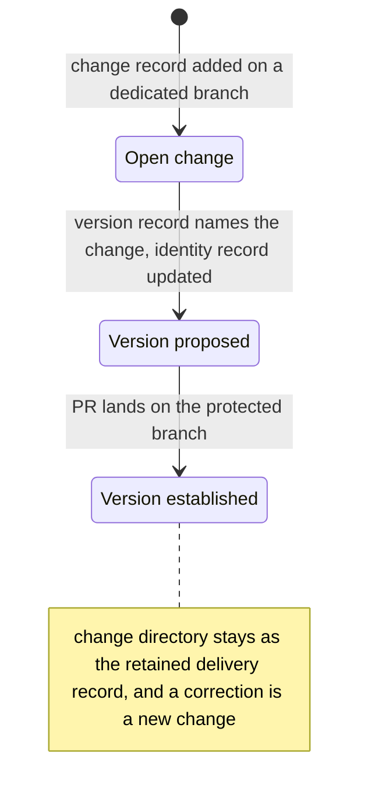
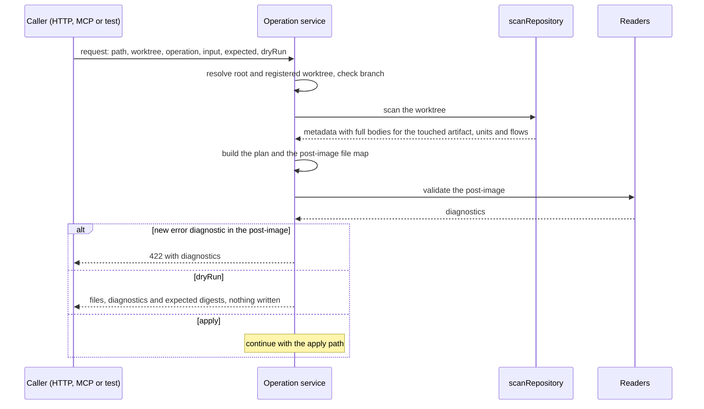
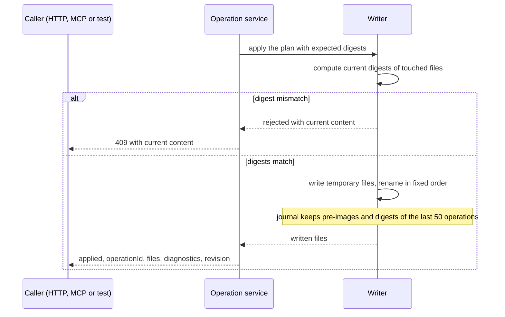
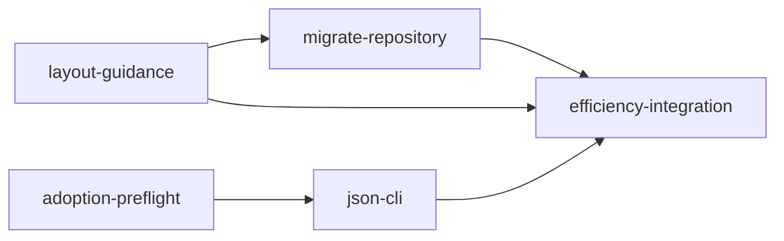
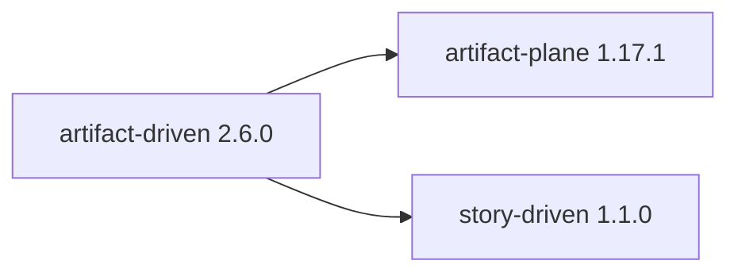
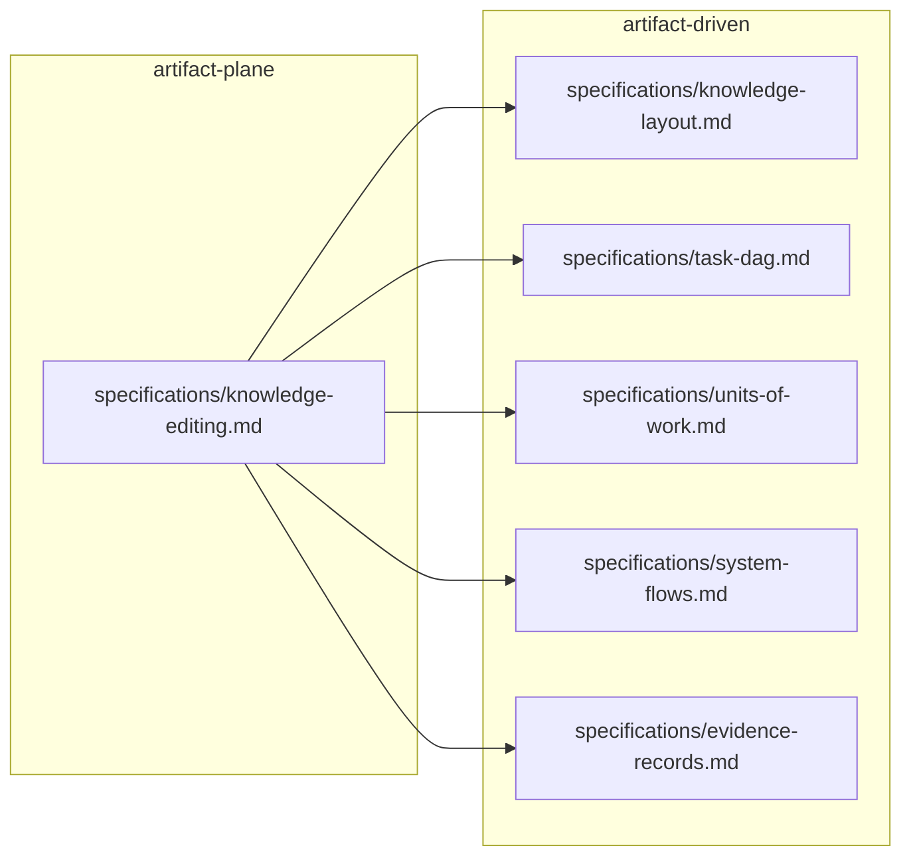
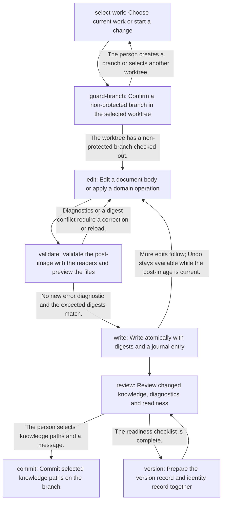
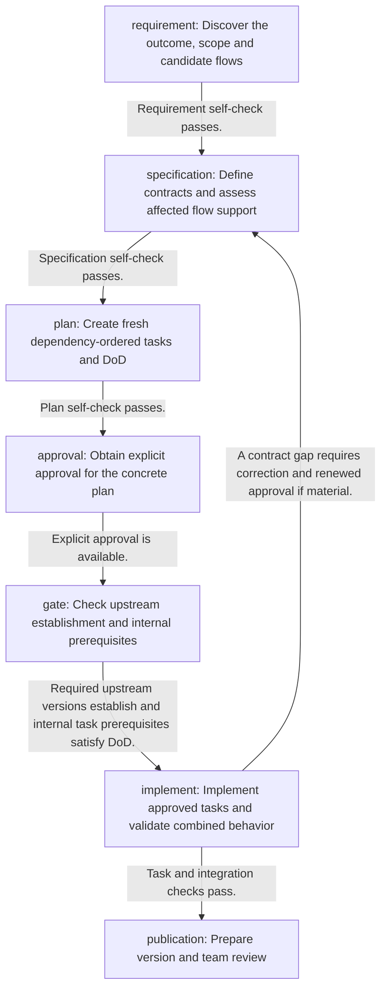

# Visual Examples

These worked examples apply the [visual representation guide](visual-representations.md) to the artifacts of the repository that maintains ADD, at revision 126990d of 18 October 2026. They follow one outcome, the in-place knowledge layout, through Requirement, Specification, ADR, Plan, Implementation and Version, and then show views across artifacts and a runtime flow. The examples name each source element by its [logical identity](../01-foundation/artifact-model.md#identities). The source artifacts were not edited.

Each example has six parts: the existing representation, the semantic model, the better representation, the reason, what stays in text, and the consistency rule. Two examples keep the existing form, because the guide selects no new representation for them.

## E1 — Requirement: Compare Two Layouts

**Existing representation.** `artifact-driven:requirements/knowledge-layout.md` gives a measurement table of twelve observations, for example "920 copies in 202 groups, 4,187,390 bytes (72.2 percent)". The specification `artifact-driven:specifications/knowledge-layout.md` shows the new layout as a text listing. The legacy layout is a list of four bullets in the legacy section of the artifact model. A reader who wants to know what changes must combine three places.

**Semantic model.** One containment relation, directory contains record, in two layouts. The compared items are the artifact root, the knowledge directories, a change and a version.

**Better representation.** Keep the measurement table: exact values are a symbolic task, and the table already fits it. Add paired listings in the same order, so that each line of the legacy listing faces the same item of the in-place listing.

Legacy layout:

```text
<artifact>/
  README.md                     current version and dependencies in Markdown sections
  changes/<change>/
    README.md                   change README
    requirements/ specifications/ decisions/   complete copy of the current version
    dependencies.yaml           proposed edges, add and remove lists
    tasks/                      plan, DoD and evidence
  versions/<version>/
    requirements/ specifications/ decisions/   complete copy of the result
    tasks/                      version-owned tasks, in versions without delivery_tasks
docs/artifacts/dag.yaml         index of established dependencies
```

In-place layout:

```text
<artifact>/
  README.md                     identity record: current_version, depends_on
  requirements/ specifications/ decisions/     working knowledge, once
  changes/<change>/
    README.md                   change record: reason and scope
    tasks/                      plan, DoD and evidence
  versions/<version>/
    README.md                   version record: source_change
```

Source: artifact-driven:specifications/knowledge-layout.md, sections Layout and Migration, and the legacy layout section of the bundle artifact model; derived one line per directory or record that the sources name; revision 126990d.

**Reason.** P2 and P3: aligned listings put the compared items next to each other and remove the search across three places (findings 1 and 5, spatial contiguity). The table stays because exact values fit a table (finding 2).

**What stays in text.** The rules for layout detection, nested directories, the derived facts and the legacy compatibility.

**Consistency rule.** The listings show only directories and records that the sources name. When the layout specification changes, regenerate the in-place listing from it.

## E2 — Specification: Lifecycle of a Change

**Existing representation.** In `artifact-driven:specifications/knowledge-layout.md`, the Lifecycle section is a list of five steps. The Derived facts table defines when a change is open and when a version is established. The states are not named in the list; the reader must combine the two sections.

**Semantic model.** Three states of one change: open change, version proposed, version established. Transitions: lifecycle step 1 starts the change; step 4 adds a version record whose `source_change` names the change, so the derived rule no longer reports it as open; step 5 lands the PR on the protected branch. After establishment the change directory stays as the retained delivery record. A defect found later becomes a new change.

**Better representation.** A state diagram. Each arrow is an event that moves the change to the next state.



Source: artifact-driven:specifications/knowledge-layout.md, Lifecycle steps 1, 4 and 5 and the Open change and Established version rows of Derived facts; derived one state per derived fact and one transition per lifecycle step that changes it; revision 126990d.

Count check: 3 states and 3 transitions, the first from the initial marker.

**Reason.** P2 and P3: the diagram joins two sections that the reader must otherwise integrate (finding 6, split attention), and a lifecycle with states fits a state diagram. The benefit is small, because the list has five steps and no branch. The diagram is justified only because the states come from the Derived facts table and not from the list.

**What stays in text.** Requirement, Specification, Plan, approval and Implementation happen while the change is open; they are phases, not states, and the diagram does not show them. The exact derivation rules stay in the table.

**Consistency rule.** States and transitions come from the derived-fact rows and the lifecycle steps. When either changes, regenerate the diagram or add a stale line.

## E3 — Specification: Write Path of Knowledge Editing

**Existing representation.** The Operation service section of `artifact-plane:specifications/knowledge-editing.md` describes the processing in one sentence with seven parts. The Validation paragraph defines status 422, and the Writer section defines expected digests, status 409, atomic replacement and the journal. The order of these events spreads across three sections.

**Semantic model.** Parties: the caller (HTTP route, MCP tool or test), the operation service, the repository scan (`scanRepository`), the readers that validate, and the writer. Messages, in order: request; resolve the root and registered worktree and check the branch; scan; build the plan and the post-image; validate; reply with 422, return a dry-run preview, or apply. The apply path: compute current digests; reply with 409 on a mismatch; otherwise write temporary files and rename them, keep the journal entry, and return the response.

**Better representation.** Two sequence diagrams, because the write path has more than ten messages. Solid arrows are calls; dashed arrows are replies.





Source: artifact-plane:specifications/knowledge-editing.md, sections Operation service (Request, Processing, Validation, Response) and Writer (Atomic replacement, Expected digests, Journal and undo); derived one message per processing step and one alternative per stated outcome; revision 126990d.

Count check: the first diagram has 4 parties, 9 messages and 1 note, the second 3 parties and 7 messages; together they show the 9 parts that the contract names: request, scan, plan, post-image, validation, dry run, digests, atomic write and journal, plus the response.

Gap, as the source states it: the contract describes the journal in the Writer section but does not name the module that records it. The diagram therefore shows the journal as a note, not as a message.

**Reason.** P2 and P3: an ordered interaction among parties fits a sequence diagram (selection guide), and the outcomes 422, 409 and dry run become visible branches. Segmenting into two diagrams follows the size rule (finding 5, segmenting).

**What stays in text.** Containment rules, partial-write recovery, undo, the other status codes, the identifier rule, templates and the operations table. The diagrams show the order; they do not replace the contract.

**Consistency rule.** When the Processing sentence, the validation rule or the writer rules change, regenerate the diagrams from the fact list or add a stale line.

## E4 — ADR: Keep the Alternatives Table

**Existing representation.** `artifact-driven:decisions/011-in-place-knowledge-layout.md` compares five options, A to E, in a table with a description and an assessment. Option B is selected; the other four are rejected for stated reasons.

**Semantic model.** Five options, one attribute set, one selection. The options do not branch from each other.

**Better representation.** None. The table is already the first choice for options and trade-offs, and the choice is linear. A decision tree would draw a branching that the source does not state (P3, finding 10).

**Reason.** The rule for choosing no representation applies: a table already holds the facts.

**What stays in text.** Everything.

**Consistency rule.** Add a representation only when a later ADR states options that depend on each other.

## E5 — Plan: Derive the Task Graph

**Existing representation.** The plan `artifact-driven/change-agent-efficiency` lists five tasks in a numbered list with "after" phrases. The task files declare `id` and `depends_on`. The plan self-check says that "four internal edges resolve"; the declarations give five edges. Prose drifted from the records.

**Semantic model.** One node per task in the `tasks` list, one edge per `depends_on` entry, from prerequisite to dependent.

**Better representation.** The task graph that a reader derives from the records. For readers without a reader tool, the derived copy is embedded below. Each arrow means that the task at the start must meet its DoD before the task at the end begins.



Source: artifact-driven/change-agent-efficiency, the `tasks` list of tasks/README.md and the `id` and `depends_on` of its five task files; derived one node per listed task and one edge per `depends_on` entry; revision 126990d.

Count check: 5 tasks and 5 edges; acyclic.

**Reason.** P1 and P5: the graph comes from the records, so it cannot drift as the self-check sentence did (finding 12: most documentation problems are wrong or outdated content). Hand-drawn task order is a prohibited form in Plan.

**What stays in text.** Task titles, scope, DoD, the concurrency note and the approval section.

**Consistency rule.** Regenerate the embedded copy from the records whenever a task or a `depends_on` entry changes. Write counts in a self-check only from the derived graph.

## E6 — Implementation: Evidence Table

**Existing representation.** The unit brief `add-agent-efficiency` lists seven acceptance criteria and seven evidence entries in YAML front matter. The Combined checks section explains the results in prose and a measurement table.

**Semantic model.** For each criterion: method, result and source. Seven criteria, seven entries, four distinct sources, one failed result.

**Better representation.** An evidence table derived from the `evidence` front matter.

| Criterion | Method | Result | Source |
| --- | --- | --- | --- |
| layout | Bundle guidance, scaffold test and Plane layout reader checks. | passed | task 01-layout-guidance, Evidence |
| migration | Reconciliation, byte equality, graph and census checks of the migration. | passed | task 04-migrate-repository, Evidence |
| adoption | Go preflight and CLI tests, benchmarks and binary smoke test. | passed | task 02-adoption-preflight, Evidence |
| context | Same-session walkthrough with read-count and byte proxies. | passed | task 01-layout-guidance, Evidence |
| consistency | Bundle review, mirror parity, link check and legacy-unit comparison. | passed | unit brief, Combined checks |
| measurements | Census and layout benchmark on the legacy and migrated forms. | failed | unit brief, Combined checks |
| integration | Go, bundle, adoption, scaffold, website build and link checks. | passed | unit brief, Combined checks |

Source: unit add-agent-efficiency, `acceptance` and `evidence` front matter; derived one row per evidence entry, in front matter order; tasks of artifact-driven/change-agent-efficiency; revision 126990d.

Count check: 7 criteria, 7 entries, 4 distinct sources, 1 failed result.

**Reason.** Evidence traceability is an exact lookup per criterion, so a table fits it (finding 2). A graph from criteria to sources was tried and rejected: its long source labels hide the result, and it shows nothing that the table does not.

**What stays in text.** The explanation of the failed packet target and the open user decision. Results are recorded claims; the table does not verify them.

**Consistency rule.** The table follows the `evidence` front matter. A failed result stays visible.

## E7 — Version: Feature Evolution

**Existing representation.** Six version records in two artifacts describe the outcome, each in its own file, and the introducing commits give the dates. A reader must open six files and the Git log.

**Semantic model.** For each version: artifact, version, `source_change`, introducing first-parent commit and its PR, and the summary of the record.

**Better representation.** A feature evolution table.

| Version | Source change | Introduced by | Summary from the version record |
| --- | --- | --- | --- |
| artifact-driven@2.3.0 | change-evidence-and-usability | 6a0e0c9, PR #28 | Explicit evidence records and the minimal change scaffold; the predecessor of the layout. |
| artifact-plane@1.13.0 | change-ux-simplification | 2225e35, PR #26 | Simpler exploration and reading; the predecessor of in-place reading. |
| artifact-driven@2.4.0 | change-agent-efficiency | b530581, PR #29 | The in-place layout for new and migrated artifacts; the legacy layout stays readable. |
| artifact-plane@1.14.0 | change-evidence-and-usability | b530581, PR #29 | In-place reading beside the legacy layout. |
| artifact-driven@2.5.0 | change-legacy-conversion | db96778, PR #30 | An optional step converts retained legacy records. |
| artifact-plane@1.15.0 | change-legacy-conversion | db96778, PR #30 | The history conversion script. |

Source: the six version records and the first-parent commits that introduced them on main; derived one row per version record; revision 126990d.

**Reason.** Exact values over several attributes fit a table (finding 2). A timeline picture would add only position on an axis, and the dates are already in order.

**What stays in text.** Compatibility reasons and complete summaries stay in the version records.

**Consistency rule.** Add a row for each new version record. Do not edit established rows.

## E8 — Across Artifacts: Dependencies and Their Reasons

**Existing representation.** The identity records declare `depends_on`. The reasons are the `references` front matter of consumer elements, for example the five references of `artifact-plane:specifications/knowledge-editing.md`.

**Semantic model.** Two graphs with different meanings. Artifact graph: three artifacts, two edges, from upstream to dependent. Element references: one consumer element, five supplier elements, grouped by artifact.

**Better representation.** Two diagrams, because the edge meanings differ (rule 6). In the first, each arrow means that the upstream artifact establishes before dependent implementation.



Source: the identity records of artifact-driven, artifact-plane and story-driven; derived one node per artifact with `current_version` and one edge per `depends_on` entry; revision 126990d.

In the second, each arrow means that the consumer element uses knowledge of the supplier element. The groups are the owning artifacts.



Source: artifact-plane:specifications/knowledge-editing.md, `references` front matter; derived one edge per reference, grouped by owning artifact; revision 126990d.

| Supplier element | Requires |
| --- | --- |
| artifact-driven:specifications/knowledge-layout.md | In-place layout records, identities, derived facts and the migration procedure that every write preserves. |
| artifact-driven:specifications/task-dag.md | Plan membership, task id and depends_on rules that task operations enforce before writing. |
| artifact-driven:specifications/units-of-work.md | Unit brief fields, membership uniqueness, evidence and provenance rules that unit operations enforce. |
| artifact-driven:specifications/system-flows.md | Flow document fields and validation that flow operations enforce. |
| artifact-driven:specifications/evidence-records.md | self_check, evidence_records and publication_reviews rules for the recording operations. |

Count check: 3 artifacts and 2 edges; 1 consumer, 5 suppliers and 5 references.

**Reason.** P3 and P4: the artifact edge says that a prerequisite exists; the references say why. The arrows also point in opposite directions: from upstream to dependent in the first diagram, from consumer to supplier in the second. Separate pictures keep one meaning per arrow, and the reasons stay in a table because they are exact text (finding 2). The grouping shows which artifact edge the references explain (finding 10, grouping by enclosure).

**What stays in text.** The `requires` reasons, the established and proposed labels, and unresolved targets.

**Consistency rule.** Both diagrams follow the front matter. A reader-derived dependency view is primary; the embedded copy is for readers without one.

## E9 — Runtime: Flows Beside the Other Graphs

**Existing representation.** The flow records `artifact-plane:knowledge-authoring` and `artifact-driven:change-delivery` define steps, transitions with conditions, and supports in YAML front matter. The body explains them. Without a reader tool, a reader must assemble the paths from the YAML.

**Semantic model.** One node per step, one edge per transition with its condition. Loops are valid.

**Better representation.** A flow diagram for each record. Each arrow is a behavior transition, labelled with its condition when the record states one. It is not an execution order or a prerequisite.



Source: artifact-plane:knowledge-authoring, `steps` and `transitions` of the flow record; derived one node per step and one edge per transition, with the condition as the label; revision 126990d.



Source: artifact-driven:change-delivery, `steps` and `transitions` of the flow record; derived one node per step and one edge per transition, with the condition as the label; revision 126990d.

Count check: knowledge-authoring has 8 steps and 11 transitions, 4 of them back to an earlier step; change-delivery has 7 steps and 7 transitions, 1 of them back to an earlier step.

The same work appears in four graphs. They look alike, but each arrow means something different:

| Graph | Example | Nodes and edges | Arrow means |
| --- | --- | --- | --- |
| Phase order | The five phases of the workflow | 5 phases | The next phase uses the output of the previous one |
| Flow graph | artifact-driven:change-delivery | 7 steps, 7 transitions, 1 loop | Behavior moves on when the condition holds |
| Task graph | artifact-driven/change-agent-efficiency (E5) | 5 tasks, 5 edges | Prerequisite task meets its DoD first |
| Artifact graph | E8 | 3 artifacts, 2 edges | Upstream version establishes first |

**Reason.** P3: the flow graph of change-delivery has approval, gate and publication steps and a loop, so it is not the phase order. Separate pictures with a declared arrow meaning prevent a reader from reading one graph as another (findings 9 and 10).

**What stays in text.** Supports, participants, interactions, gaps and exclusions of each flow, and the trigger and outcome.

**Consistency rule.** A reader tool derives these diagrams from the flow records and is the primary view. Regenerate an embedded copy when a step or transition changes.
