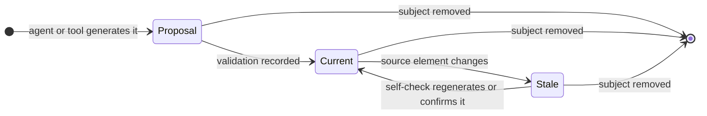

# Visual Representations

Use this guide when you write, review or change a table, listing, diagram or derived view in ADD knowledge. The principles and their research basis are in [visual knowledge](../01-foundation/visual-knowledge.md). The [worked examples](visual-examples.md) apply this guide to real artifacts. The [diagram scopes example](diagram-scopes-example.md) applies the scopes, the selection matrix and the icons to an invented system on AWS.

The text is the knowledge. Structural facts stay in YAML front matter, and the Markdown body explains them. A representation presents knowledge that the text already states. It adds no fact, phase, review step or workflow state.

## Categories

| Category | Shows | Generation | Validation | Examples |
| --- | --- | --- | --- | --- |
| Semantic diagram | Precise relationships that the source states: prerequisites, transitions, interactions, containment, consumption, lifecycle. | From a fact list taken from front matter or body sentences. Every node and edge maps to one fact. | Count the nodes and edges against the fact list. Confirm that no element is extra, missing or reversed, that labels and directions equal the source, that the notation renders, and that the text alternative agrees. Record the check in the owning self-check or task evidence. | Task graph, flow diagram, write-path sequence, lifecycle state diagram |
| Explanatory illustration | A concept, analogy or comparison that helps a reader form a mental model. | From the concept, labelled `Illustrative:`. | Review that it contradicts no source fact and that its text says what it does not encode. | Comparison of two layouts, a labelled example scenario |
| Interactive knowledge view | Navigation, exploration and editing over structured records. | Derived by a reader tool from records. Never authored. | The reader's own validation and diagnostics. | Dependency, task, unit and flow graphs of a reader tool |

Tables and listings are semantic representations or illustrations according to their content. The same rules apply to them.

## Scopes

A diagram has one of two scopes.

| Term | Meaning |
| --- | --- |
| System scope | The whole system: its boundary, its applications and data stores, its deployment and the behavior that crosses artifacts. |
| Artifact scope | The contracts and the behavior that one artifact owns. |
| System view | A diagram at system scope. |
| Artifact view | A diagram at artifact scope. |
| System owner | The ordinary artifact that owns a system view. |
| System view document | A working knowledge document whose front matter declares `system_view: true`. |
| Owner table | The table after a system view that names, for each element of the view, its owning artifact and its governing knowledge. |
| Icon | A small picture on a diagram node, from a named icon pack. |

### Ownership and discovery

1. A system view has one system owner. The project chooses an ordinary artifact for it, for example `platform`. The README of that artifact says in its purpose that it owns the system views. A project can give a view to a second artifact, for example a trust boundary view to a security artifact. Each view still has one owner.
2. A system view document declares `system_view: true` in its YAML front matter. The key is valid in requirement, specification and decision documents of the working knowledge. A flow record does not declare it. Readers ignore the key with any other value.
3. Readers find the system views of a repository from these declarations. No registry, index file or list in another document exists.
4. Other artifacts link to a system view document. They do not copy its diagrams or its facts.
5. Each system view is followed by its owner table. Each row names an element as the view labels it, its owning artifact, and a link to the governing knowledge of the element. An external actor or system has no owning artifact; its row says `external`.
6. A document with artifact views links once, in its introduction, to the system view document that shows the artifact. A reader goes from the system view to the artifact through the owner table, and back through this link.
7. Diagrams contain no links and no click directives. Links stay in the text.

### Edge meanings

Each view declares the meaning of its arrows in its introduction. The views at both scopes use these meanings:

| View | Arrow or grouping | Meaning |
| --- | --- | --- |
| System context, logical architecture, critical end-to-end flow, component, sequence, security or data flow | Arrow | Runtime interaction: the source calls, sends to or uses the target. |
| Deployment overview, deployment detail, resilience | Subgraph | Placement: the element runs or is stored in the subgraph. |
| Deployment overview, deployment detail, resilience | Arrow | Network traffic from the caller to the callee, with an optional protocol or path label. |
| Network and trust boundaries | Subgraph | A trust zone. |
| State | Arrow | A transition with its event. |
| Flowchart or activity | Arrow | The next step, with its condition. |
| Data model | Line | A relationship with its cardinality. |

No view draws artifact prerequisites, task prerequisites or element references. Readers derive these graphs from records ([four graphs](#four-graphs-four-meanings)). The owner table, not an arrow, maps an element to its owning artifact.

### One flow authority

A behavior that crosses artifacts has one flow record in one owning artifact ([system flows](system-flows.md)). A critical end-to-end flow view is derived from that record. Its source line names the flow identity, for example `ordering:place-order`. An artifact view of part of the behavior links to the flow record and shows only the detail that its artifact owns. When a reader shows the flow from its record, a document links to that view and does not draw the flow again.

## Selection Matrix

Choose the scope first, then the view. The scores guide selection; they set no count. Suitability says how well the view shows its information, from 1 to 5. Necessity says how much a reader needs the view when its condition holds, from 1 to 5. Prefer the one or two views that solve the main comprehension problem. A simple system or a simple artifact uses prose or a table.

### System scope

| View | Purpose | Owner | Suitability | Necessity | Select when | Omit when |
| --- | --- | --- | --- | --- | --- | --- |
| System context | Actors, the system boundary and external systems | System owner | 5 | 4 | People or other systems use the system | One user and no external system; one sentence says it |
| Logical architecture (C4 container level) | Applications, data stores, their responsibilities and communication | System owner | 5 | 4 | The system has more than one application or data store | One application with one store |
| Deployment overview | Software placed on infrastructure for one named environment | System owner | 5 | 4, conditional | Placement, managed services or the environment affect a contract | The platform hides placement, or one process runs on one host |
| Network and trust boundaries | Trust zones, entry points and the traffic that crosses them | System owner or a security artifact | 5 | 3, conditional | Sensitive data or more than one trust zone | One trust zone and no sensitive data |
| Critical end-to-end flow | One behavior across artifacts | Owner of the flow record | 4 | 3 | Readers must follow a behavior across artifacts | A reader shows the flow from its record; link to it |
| Resilience and disaster recovery | Redundancy, backups, failover and recovery objectives | System owner | 4 | 2, conditional | The knowledge states recovery objectives or more than one region | No recovery objective is stated |
| Delivery pipeline | Build, test, release and deployment stages | Artifact that owns delivery | 3 | 2, conditional | More than one stage or environment | The pipeline configuration is short and readable |

### Artifact scope

| View | Purpose | Owner | Suitability | Necessity | Select when | Omit when |
| --- | --- | --- | --- | --- | --- | --- |
| Sequence | Ordered interaction among participants | The artifact | 5 | 4 | Multiple participants, asynchronous work, errors, timeout or retry | Two participants with one request and one response |
| State | A lifecycle with states and transitions | The artifact | 5 | 4, conditional | The artifact owns a nontrivial lifecycle | Two states, or transitions without conditions |
| Data model | Entities, relationships and constraints | The artifact | 5 | 4, conditional | The artifact owns data relationships and constraints | One entity, or a table lists the fields |
| Flowchart or activity | Steps with branches, loops or compensation | The artifact | 4 | 3 | Branching rules, loops or compensation | Five steps or fewer and no branch |
| Component | Internal responsibilities and their interaction | The artifact | 4 | 3 | Internal responsibilities need explanation | One responsibility |
| Deployment detail | Placement, scaling or runtime topology of the artifact | The artifact | 5 | 4, conditional | Placement, scaling or runtime topology affects the contract | The deployment overview shows enough |
| Security or data flow | Sensitive data, permissions and trust boundaries of the artifact | The artifact | 5 | 4, conditional | Sensitive data, permissions or trust boundaries need explanation | No sensitive data and one trust zone |

### Notation

| View | Notation |
| --- | --- |
| System context, logical architecture, network and trust boundaries, critical end-to-end flow, delivery pipeline, flowchart or activity, component, security or data flow | `flowchart`, with `subgraph` for boundaries and optional icon shapes |
| Deployment overview, deployment detail, resilience | `flowchart`, with nested `subgraph` blocks for placement (account, region, network) and icon shapes |
| Sequence | `sequenceDiagram` |
| State | `stateDiagram-v2` |
| Data model | `erDiagram` |

Do not use `architecture-beta` for these views. Its automatic layout overlaps or stretches nodes above about eight services, it draws no edge labels, and it breaks hyphenated labels inside words. Do not use the Mermaid C4 diagram types; their syntax is experimental and their layout is fixed. A `flowchart` shows each C4 level and each deployment.

An icon shape in a `flowchart` has this form: `api@{ icon: "logos:aws-api-gateway", form: "square", label: "Orders API", pos: "b" }`.

## Selection Guide

"Derived from" names the records that a reader or an agent regenerates the representation from. "No" means that the facts exist only in prose.

| Information | First choice | Alternative | Derived from | Limits and cost |
| --- | --- | --- | --- | --- |
| Exact values, attributes of options, trade-offs | Table | List | No | Split a table with more than about seven columns. Tables fit symbolic tasks. |
| Ordered interaction among parties: requests, operations, events | Sequence diagram | Numbered steps | Flow step interactions and participants, or body sentences | Segment above about ten messages. Name the parties as the source names them. |
| Lifecycle with states and transitions | State diagram | State-by-event table | Lifecycle sentences and derived-fact tables | Label the conditions on transitions. States are facts of the source, not phases. |
| Prerequisite order: artifact dependencies, task prerequisites | Directed graph, arrow from prerequisite to dependent | Edge list | Identity records; the tasks list and task `depends_on` | Draw declared edges only, not transitive edges. The reader-derived view is primary. |
| Behavior journey with branches and loops | Flowchart from transitions, with conditions on edges | Step list with "to step n when" | Flow record | Loops are valid. A flow is not a DAG and not an execution order. |
| Containment and hierarchy: layout, components, bounded contexts | Tree listing or nested groups | Indented list | Directory listing or body text | Show only the depth that the reader needs. |
| Change impact and consumers | Graph of element references grouped by artifact, consumer to supplier | Table of consumer, supplier and reason | `references` front matter | It is not the dependency graph. Show unresolved targets as unresolved. |
| Evidence traceability: criterion, check, result, source | Table | Graph for navigation | Unit evidence; task `evidence_records` | Results are recorded claims, not verification. |
| Quantities and measurements | Table | Chart only when a trend matters | Measurement tables | Position encodes most accurately. Rarely necessary. |
| Responsibility by role or phase | Table | Swimlane diagram | Workflow tables | Phases are not runtime states. |
| Before and after a change | Two-column comparison or paired listings | Prose with the difference | Established and proposed knowledge | Align the compared items. |
| A concept or mental model | Worked example with concrete values | Explanatory illustration | Requirement examples | Label illustrations. Reduce examples for expert readers. |

Use no representation when:

- the relationship covers four items or fewer with one relation;
- a table already holds the facts;
- a sequence has five steps or fewer and no branch;
- a reader-derived view already shows the structure;
- the picture would only decorate.

## Authoring Rules

1. **Notation.** Use Mermaid in a fenced block labelled `mermaid`. Prefer `flowchart`, `sequenceDiagram`, `stateDiagram-v2`, `classDiagram` and `erDiagram`. A `flowchart` can use icon shapes with the [supported icons](#icons). Do not use `architecture-beta` or the C4 diagram types; the [notation table](#notation) gives the reason. Do not use click directives, HTML in labels, init directives or external resources. Do not put a semicolon in an unquoted label, because Mermaid reads it as the end of a statement. Another text-defined notation is acceptable when all readers of the knowledge render it; name the notation in the source line.
2. **Order.** Put these items in this sequence: one introduction paragraph that says what the picture shows and what its arrows mean; the fenced block with `accTitle` and `accDescr`; the source line. The body text carries the facts. When the surrounding text does not state them, add a list after the source line.
3. **Source line.** Write `Source: <logical identities>; derived <rule>; <revision or "current snapshot">`. Use the forms of the [identity table](../01-foundation/artifact-model.md#identities). An explanatory illustration starts the line with `Illustrative:` instead of `Source:`.
4. **Labels and edges.** Node identifiers use letters, digits and underscores. Labels use the identifier or title of the element as the source writes it. State the arrow meaning once per diagram. Solid edges mean established relationships; dotted edges (`-.->`) mean proposed relationships.
5. **Size.** Use about 15 nodes or 25 edges at most per diagram. Split a larger graph into an overview and detail diagrams. An overview names its detail views in its text, and the source line of a detail view names its overview. A `flowchart` with icon shapes and more than about six nodes on its longest path uses `flowchart TB`, so that it fits the text column; split it when it is still wider. Keep a label to about 40 characters, and put more detail in the owner table or in the text.
6. **Facts.** Draw only relationships that the source states. Mark gaps and unresolved targets as the source marks them. Do not combine phase order, task prerequisites, artifact prerequisites, flow transitions or element references in one picture.
7. **Stale marking.** When a source changed and nobody has rechecked the diagram, add the line `Stale: <identity> changed; recheck pending.` after the source line. Remove the line when the self-check regenerates or confirms the diagram.
8. **Generated output.** A diagram from an agent or a tool is a proposal until the validation of procedure step 9 is recorded. Image output of a generative model is never a semantic diagram.

The diagram below shows rules 7 and 8 as the states of one embedded diagram. Each arrow is an event that changes the state of the diagram.

Source: authoring rules 7 and 8 and procedure step 10 of this guide; derived one state per stated condition and one transition per stated event; current snapshot.

## Icons

Readers that render icons bundle these packs. A diagram uses no other icon.

| Source | Prefix | Names | License | Packaging |
| --- | --- | --- | --- | --- |
| Iconify `logos` 1.2.18 | `logos` | The 65 names that start with `aws` | CC0-1.0. The logos are trademarks of their owners. | A reader bundles the subset. |
| Iconify `lucide` 1.2.147 | `lucide` | `user`, `users`, `globe`, `cloud`, `smartphone`, `monitor`, `server`, `database`, `hard-drive`, `mail`, `lock`, `shield`, `key-round`, `inbox`, `network`, `container`, `box`, `git-branch`, `workflow`, `layers`, `credit-card`, `bell`, `file-text`, `cog` | ISC; `database`, `lock`, `monitor`, `server` and `smartphone` derive from Feather and are MIT. A reader that bundles the icons keeps the whole Lucide license file. | A reader bundles the subset. |

The 65 `logos` names are: `aws`, `aws-amplify`, `aws-api-gateway`, `aws-app-mesh`, `aws-appflow`, `aws-appsync`, `aws-athena`, `aws-aurora`, `aws-backup`, `aws-batch`, `aws-certificate-manager`, `aws-cloudformation`, `aws-cloudfront`, `aws-cloudsearch`, `aws-cloudtrail`, `aws-cloudwatch`, `aws-codebuild`, `aws-codecommit`, `aws-codedeploy`, `aws-codepipeline`, `aws-codestar`, `aws-cognito`, `aws-config`, `aws-documentdb`, `aws-dynamodb`, `aws-ec2`, `aws-ecs`, `aws-eks`, `aws-elastic-beanstalk`, `aws-elastic-cache`, `aws-elasticache`, `aws-elb`, `aws-eventbridge`, `aws-fargate`, `aws-glacier`, `aws-glue`, `aws-iam`, `aws-keyspaces`, `aws-kinesis`, `aws-kms`, `aws-lake-formation`, `aws-lambda`, `aws-lightsail`, `aws-mobilehub`, `aws-mq`, `aws-msk`, `aws-neptune`, `aws-open-search`, `aws-opsworks`, `aws-quicksight`, `aws-rds`, `aws-redshift`, `aws-route53`, `aws-s3`, `aws-secrets-manager`, `aws-ses`, `aws-shield`, `aws-sns`, `aws-sqs`, `aws-step-functions`, `aws-systems-manager`, `aws-timestream`, `aws-vpc`, `aws-waf`, `aws-xray`.

The Lucide license file holds the ISC notice and an MIT notice for the icons that Lucide derives from Feather. Five of the 24 names are on that list: `database`, `lock`, `monitor`, `server` and `smartphone`.

1. Use only icons of this set. A name outside the set renders as Mermaid's unknown-icon mark.
2. Give every node with an icon a text label. The icon never carries the only meaning.
3. Use a vendor logo only for that product. Use a `lucide` icon for a generic role, such as a person, a browser or a queue that no product names.
4. Do not use the `img` form of a node or any other image reference. A diagram loads no remote resource.
5. Mermaid's built-in architecture icons (`cloud`, `database`, `disk`, `internet`, `server`) resolve only in `architecture-beta`. The `lucide` names `cloud`, `database`, `hard-drive`, `globe` and `server` replace them in a `flowchart`.

## Reader Fallback

Readers differ in what they draw. This table states what each reader shows, as observed on 27 October 2026.

| Content | Artifact Plane | GitHub Markdown | Documentation website |
| --- | --- | --- | --- |
| `flowchart`, `sequenceDiagram`, `stateDiagram-v2`, `erDiagram` | Renders | Renders | Renders |
| Icon of the `logos` or `lucide` subset | Renders the icon | Unknown-icon mark and the label | Unknown-icon mark and the label |
| Icon name outside the set | Unknown-icon mark and the label | Unknown-icon mark and the label | Unknown-icon mark and the label |
| Block that does not parse | Source text and a note | The reader's error message; the file keeps the source | The reader's error message; the file keeps the source |

Artifact Plane renders the icons in the release that bundles the packs; an earlier release shows the unknown-icon mark. The text of the document, the owner table and the source line keep every fact readable in each case.

## Agent Procedure

Apply these steps when you create, review or change a representation. They run inside the existing phase self-check or task check and add no phase.

1. **Analyze.** Read the purpose, the front matter and the body structure of the element. List the relationships that the text states: sequence, states, prerequisites, containment, consumption, comparison and quantities. Note the readers and their expertise.
2. **Identify difficulty.** Mark passages where a reader must keep more than about four related items in mind, follow a sequence across paragraphs, compare more than two options on more than two attributes, or follow a path across documents.
3. **Decide.** A representation is justified when a relationship from step 1 is the subject of the passage, a reader task needs search or comparison that the prose spreads apart, and no derived view or table already shows it. Otherwise keep the prose and record the decision in one sentence.
4. **Select.** Choose the scope first, then the view from the [selection matrix](#selection-matrix). Use the selection guide for the other information. Prefer the reader-derived view for structural facts and a table for exact comparison. Use one representation per relationship.
5. **Model.** Write the fact list that the representation will show: nodes, edges, labels and states, each with the identity of its source. Include only stated facts. Mark gaps as gaps.
6. **Generate.** Write the notation from the fact list under the authoring rules.
7. **Explain.** Write the introduction paragraph. Check that the body text carries every fact of the picture.
8. **Link.** Write the source line. Name nodes so that a reader can find the elements. Put links to governing elements in the text, not in the diagram.
9. **Validate.** Count nodes and edges against the fact list. Confirm that no element is extra, missing or reversed, that labels equal the source, that the notation renders or parses, that the text alternative agrees, and that the layout implies no relationship. Record the check and its result in the self-check or task evidence.
10. **Maintain.** When a source element changes, regenerate the diagram from its derivation or mark it stale. Remove a representation when its subject is removed. Do not edit a diagram to show a fact that the source does not state; change the source first.

Answer each self-review question with yes before you record the check:

- Does the body state every fact that the diagram shows, and does the diagram show only stated facts?
- Does each arrow style have one declared meaning, and are graphs with different edge meanings separate pictures?
- Does a reader without the renderer get the same facts from the text?
- Does the source line name the identities and the derivation?
- Is the diagram within the size limit, or split into levels?
- Do the labels use existing identifiers and titles?
- Is a table or a reader-derived view not better for the task?
- Is the check recorded with its result?

Prohibitions:

- No decorative or redundant visuals.
- No invented behavior or relationships.
- No image-generation output as verified architecture.
- No loss of semantic precision for appearance.
- No mandatory diagramming tool.
- No simplified picture in place of complete technical knowledge.

## Phase Application

| Phase | Use | Derived from | Avoid |
| --- | --- | --- | --- |
| Requirement | Example scenarios with concrete values; before-and-after comparisons; measurement tables; a journey listing of candidate flows. | Confirmed facts and examples | Architecture pictures; invented protocol detail |
| Specification | Contract tables for inputs, outputs and errors; sequence diagrams for interactions; state diagrams for lifecycles; containment diagrams for boundaries; flow diagrams from flow records; model participation from participants and interactions. | Body sentences; flow and model records | A picture in place of the contract text |
| ADR | Alternatives table with options and criteria. A decision graph only when the options branch. | Alternatives section | A diagram of a linear choice |
| Plan | The task graph that a reader derives from the task list and the task prerequisites; an embedded derived copy when readers have no reader tool. | `tasks` list and `depends_on` | Hand-drawn task order; task edges across artifacts |
| Implementation | Evidence table: DoD item, check, result and source. Updated behavior diagrams when the behavior changed. Test and implementation supports on flow steps. | Task `evidence_records`; flow supports | A diagram as proof of execution |
| Version | Change summary table: what changed, compatibility level, affected contracts. | Version record and identity record difference | A new diagram for an unchanged structure |

These views cross artifacts. Each is derived and has its own meaning:

- feature evolution, from version records and their source changes;
- dependency navigation, from identity records;
- runtime interaction, from flow records;
- change impact, from references and flow supports in reverse;
- evidence traceability, from unit evidence and task records;
- lifecycle, from the derived-fact rules.

## Four Graphs, Four Meanings

ADD knowledge contains graphs that look alike and mean different things. Keep them in separate pictures and name the meaning of each arrow.

| Graph | Nodes | Edge meaning | Source | Shape |
| --- | --- | --- | --- | --- |
| Phase order | Phases | The next phase uses the output of the previous phase | Workflow | Sequence with returns |
| Task graph | Tasks of one change | Prerequisite task before dependent task | `tasks` list, task `depends_on` | Acyclic |
| Artifact graph | Artifacts | Upstream artifact establishes before dependent implementation | Identity records | Acyclic |
| Flow graph | Steps of one flow | Behavior transition, with a condition | Flow record | Branches, joins and loops allowed |
| Element references | Elements | Consumer uses supplier knowledge | `references` front matter | Any shape; explains artifact edges |

## Traceability and Maintenance

Each semantic diagram has a source line. Each phase self-check lists the representations of the changed documents and records, for each one, that it was regenerated or checked against its sources. A task that changes behavior rechecks the diagrams of the governing specification and reports stale diagrams to the coordinator. When a change alters a fact that a system view of another artifact shows, the unit of that change includes a change of the system owner; that change regenerates the view or adds the stale line. Version preparation confirms that no stale line remains in the working knowledge. Do not edit a representation in a retained change or an established version; a correction is a new change.

## Reader Support

A reader of ADD knowledge meets this guide when it:

- renders a fenced Mermaid block from its text without external resources, or shows the block as source text with its label, so that the introduction, the text alternative and the source line stay readable;
- renders the [supported icons](#icons) from bundled packs, or shows Mermaid's unknown-icon mark with the label;
- keeps the derived views of structural facts as the primary form, with proposed additions and removals marked;
- never treats an embedded diagram as a structural fact. Front matter is the only structural source.
