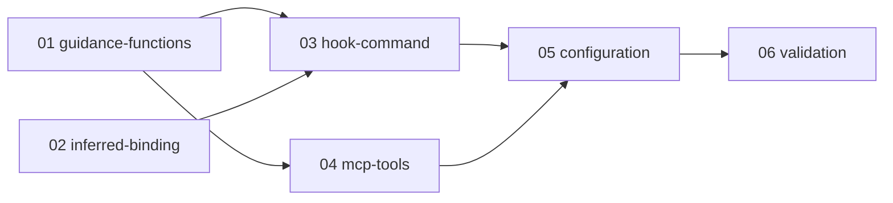

---
tasks:
  - 01-guidance-functions.md
  - 02-inferred-binding.md
  - 03-hook-command.md
  - 04-mcp-tools.md
  - 05-configuration.md
  - 06-validation.md
compatibility: minor
self_check:
  result: passed
  source: docs/artifacts/artifact-plane/changes/change-agent-integration/tasks/README.md#plan-self-check
---

# Agent integration plan

1. [Guidance functions](01-guidance-functions.md): change state, session context, reserved actions and stop check.
2. [Inferred binding](02-inferred-binding.md): the binding field and the rule that infers a binding.
3. [Hook command](03-hook-command.md): the commands of the executable and the hook dispatcher.
4. [MCP tools](04-mcp-tools.md): change state, record checks, instructions, version and default root.
5. [Configuration and guides](05-configuration.md): the files of this repository and the guides for both harnesses.
6. [Validation](06-validation.md): the live check, the flows, the claims and the version.

Tasks 01 and 02 have no prerequisite and can run in parallel in separate worktrees. The coordinator keeps the knowledge edits and tasks 05 and 06.

## Plan self-check

Every ID of requirements/agent-integration.md is in the `covers` of a task. The graph has six tasks, no cycle and one end. Each DoD item names an observable check. Compatibility is minor: new commands, MCP tools and an attempt field; existing commands, tools and observer states keep their behavior. Five claims of the specification are open for the plan approval; tasks 01, 03 and 06 check them. KISS: one new module, no new store or table. STE: one check in each DoD item.
