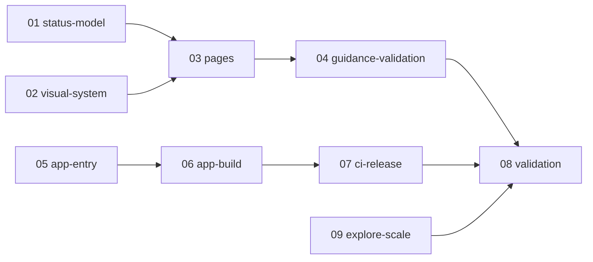

---
tasks:
  - 01-status-model.md
  - 02-visual-system.md
  - 03-pages.md
  - 04-guidance-validation.md
  - 05-app-entry.md
  - 06-app-build.md
  - 07-ci-release.md
  - 08-validation.md
  - 09-explore-scale.md
compatibility: minor
self_check:
  result: passed
  source: docs/artifacts/artifact-plane/changes/change-human-guidance/tasks/README.md#plan-self-check
---

# Human guidance and application release plan

Two independent tracks join in the final validation.

Guidance track:

1. [Status model](01-status-model.md): server fields, statuses, the stepper rule and the change brief difference.
2. [Visual system](02-visual-system.md): badge families, control grammar, glossary and narrow stepper.
3. [Pages](03-pages.md): status cards, version labels and the new components on the six main pages.
4. [Guidance validation](04-guidance-validation.md): browser tests, screenshots and the owner look.

Release track:

5. [Application entry](05-app-entry.md): the command line and the paths of a packaged server.
6. [Application build](06-app-build.md): payload, launcher, executable, smoke check and version check.
7. [CI and release](07-ci-release.md): the target matrix, the plane-v release and the README.

Added at the owner's request on 19 October 2026:

9. [Explore scale](09-explore-scale.md): the explore response of a repository with many worktrees.

Join:

8. [Validation](08-validation.md): the downloaded executable, the flow supports, the unit evidence and the version.

Tasks 01, 02 and 05 have no prerequisite and can run in parallel in separate worktrees. The coordinator keeps the knowledge edits.

## Plan self-check

Every ID of requirements/human-guidance.md, requirements/app-release.md and requirements/explore-scale.md is in the `covers` of a task. The graph has nine tasks, no cycle and one join. Each DoD item names an observable check. Compatibility is minor: new commands, statuses and release files; no route, tool or packet field changes behavior. The decision upstream-from-local-refs and the decision bundled-onnx-runtime are open for the plan approval. KISS: no new state, no installer. STE: one check in each DoD item.
