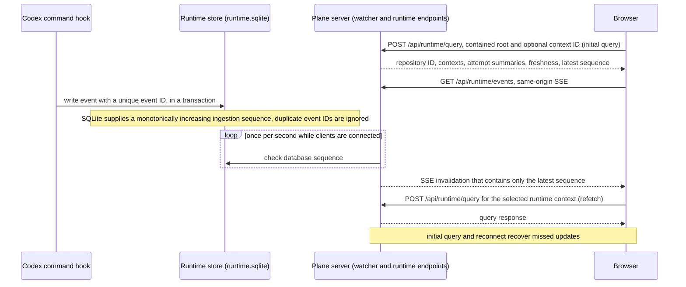

# Codex execution observation contract

## Ownership and architecture

R1–R10 are implemented by a local hook reporter, an observation store, read-only runtime HTTP endpoints, and an additive graph overlay. The established artifact-driven task/unit contracts remain unchanged. The observer adds no dispatch or scheduler. specifications/agent-orchestration.md defines the sessions that a person starts; their implementer attempts use this observation contract.

Use Node 24 built-in node:sqlite, already compatible with the app engine, and no external database service. Store runtime.sqlite under ARTIFACT_PLANE_STATE_DIR when explicitly set; otherwise use XDG_STATE_HOME/artifact-plane or ~/.local/state/artifact-plane. Reject a state directory within any registered/inspected repository or worktree, including symlink aliases. Create private directories/files (0700/0600 where supported), use WAL, transactions, a bounded busy timeout, and schema version checks. Unknown newer schemas fail diagnostically rather than being rewritten. Runtime writes are permitted only for observation data; the repository explorer still never writes inspected files or Git metadata.

## Identity and retained graph context

Register a random repository ID in the runtime store, associated with the canonical Git common directory and remaining root checkout. Bind/matching identity includes canonical source worktree, repository ID, unit ID (nullable for individual plans), artifact, originating change, task path and signature. Capture identity also includes source revision and graph digest. Apply specifications/evidence-correctness.md for aliases, legacy records and changed HEADs. Agent identity = session ID plus optional subagent ID; each binding creates an attempt ID. A session/agent has at most one active binding. Rebinding closes the prior attempt as superseded/unknown and creates a new attempt. Task IDs remain plan-local.

The table shows the fields that the sources name for each identity. "—" means that the sources do not name the field for that identity.

| Field | Binding and task matching | Capture | Agent identity |
| --- | --- | --- | --- |
| Repository ID (random, associated with the canonical Git common directory) | included | — | — |
| Canonical source worktree | included | included | — |
| Unit | unit ID, nullable for individual plans | unit selector | — |
| Artifact | included | — | — |
| Originating change | included | — | — |
| Task path (relative) | included | — | — |
| Task signature | included | — | — |
| Source revision (HEAD) | — | included, when known | — |
| Graph digest | — | included | — |
| Session ID | — | — | included |
| Subagent ID | — | — | optional |
| Attempt ID | created by each binding | — | — |

Source: artifact-plane:specifications/codex-execution.md, Identity and retained graph context paragraph 1; artifact-plane:specifications/evidence-correctness.md, Worktree-bound observation paragraph 1; derived one row per named identity field, a cell only where a source names the field for that identity; current snapshot.

The local runtime CLI provides register, bind, report, and hook commands. Bind reads the selected current plan through existing contained readers, rejects invalid/unavailable graphs or unlisted tasks, and captures immutable node/edge metadata for that plan/unit, plus its source digest and revision when available. Capture only safe labels, identity, and edges; never store arbitrary file contents. Bind does not authorize execution or verify prerequisites. Identical graphs at the same canonical worktree and source revision can share captured context. Never attach older observations to a materially changed task solely because its path matches.

Live overlays resolve exact matching context. A retained context is separately labeled Recorded execution context, with source revision/digest, capture time, and missing-worktree status. A surviving repository can list archived contexts even if the unit/change source is missing. Archived metadata is not current knowledge, approval evidence, or a historical establishment proof. Git remote URLs are not identity; do not merge unrelated clones automatically.

## Codex lifecycle adapter

Supply a Node command hook plus a configuration example, not automatic changes to user/global configuration. Support SessionStart, UserPromptSubmit, PreToolUse, PostToolUse, PermissionRequest, Stop, Interrupt, SessionEnd, SubagentStart, and SubagentStop from the documented Codex hook input. Confirm configuration parsing against installed codex-cli 0.160.1 before delivery. Documentation source: https://learn.chatgpt.com/docs/hooks . Supported fields include session_id, cwd, hook_event_name, optional turn_id, agent_id, agent_type, model, and tool_name. Claude Code sends prompt_id and no turn_id; the observer uses prompt_id as the turn when turn_id is absent (specifications/agent-integration.md). Antigravity sends camelCase hook payloads (`conversationId`, `workspacePaths`, `toolCall`, `invocationNum`, `executionNum`, `terminationReason`), which the hook adapter normalizes to the same observer fields using `conversationId` as both `session_id` and `turn_id` (specifications/agent-integration.md). Subagent lifecycle input uses the parent's session_id, so agent_id is mandatory for distinct child identity when the harness shares a session ID.

SessionStart may return hook-specific additionalContext containing the session identity and concise binding instructions. Other hooks return valid empty JSON on stdout. Errors remain fail-open: short bounded stderr diagnostics and exit 0. The only blocking decisions are the reserved-action refusal and the stop check of specifications/agent-integration.md. Do not inspect transcript_path or persist prompt, last_assistant_message, tool_input, tool_response, full shell command, or other payload text; tool_input is read only in memory for the uses of that specification. Normalize only the allowlisted fields. A hook writes directly to the local store, so Plane need not be running. A hook invocation receives a unique event ID before any database retry. Unbound session events remain in a bounded diagnostic buffer. Never guess a task from cwd, branch or prose; the only inferred binding is the task file read of specifications/agent-integration.md, labeled inferred. A start event alone does not assign a child agent its parent's task.

OpenCode 2 reaches the same observer through the [native V2 bridge](opencode-support.md). That contract owns its namespaced session/worktree identity, verified child identity, admitted-user turn correlation and conservative terminal mapping. It adds no runtime state schema and does not infer validation or failure from model output. Unknown or ambiguous delivery correlation stays unknown; the primary-checkout task-binding restrictions remain in force.

## Observation event contract and ordering

Event records include event ID, repository ID when resolved, session/agent identity, attempt ID when bound, event kind, local observedAt timestamp, source timestamp if supplied, and optional allowlisted tool/model/type labels. SQLite supplies monotonically increasing ingestion sequence; browser ordering uses this sequence. Duplicate event IDs are ignored. Concurrent hook processes are serialized by database transactions. Events can arrive late; retain their order and disclose that receipt order is not authoritative source order. Different turn IDs must not allow a delayed Stop to terminate a newer observed turn. A missing turn ID creates uncertainty rather than inferred correlation. Keep up to 10000 unbound diagnostic events; bound attempt history remains durable until explicitly removed by a future maintenance feature.

## Derived states

- No recorded execution (internal waiting state): no matching attempt; no readiness or approval assertion.
- Processing: bound UserPromptSubmit or PreToolUse observed; show last tool label and event time. SessionStart alone is idle/unknown.
- Blocked: PermissionRequest observed; next corresponding activity can clear this observation. Also allow explicit blocked reports with a bounded reason label.
- Validating: Stop or SubagentStop observed, or explicit execution-returned report. Neither hook proves success. Labels say execution returned / DoD pending.
- Interrupted: Interrupt observed for the matching main turn. No invented child interruption events.
- Failed: explicit failed report; no success/failure inference from tool output or generic Stop.
- Done: explicit validated report containing nonempty validation method and a safe existing Markdown evidence reference with nonempty check details. Mark Done (reported); an assertion is not independent verification. Runtime validation references do not replace artifact-local evidence.
- Unknown: expired active observation, restart without fresh matching activity, missing correlation, or contradictory report. Retain the last observed state and time.

Active observations expire after ten minutes without fresh matching evidence; show Unknown / last observed Processing or Blocked. This is freshness expiry, not proof the agent stopped. No heartbeat or process scanning is claimed. SessionEnd terminates activity visibility but does not prove DoD. Terminal reports are not overwritten by later unrelated tool events. Multiple attempts remain separately inspectable; concurrent attempts for one task show a count and each agent. The task projection remains Processing while any fresh attempt is Processing, then Blocked, then Validating; mixed/contradictory results are disclosed and cannot produce an unqualified Done. No runtime event changes DAG edges or establishment gates.

The table gives the condition that enters each derived state and the condition that leaves it. "Not stated" marks a gap of the source.

| State | Entered when | Left or cleared when |
| --- | --- | --- |
| No recorded execution | No matching attempt exists (internal waiting state). | Not stated. |
| Processing | A bound UserPromptSubmit or PreToolUse is observed. | After ten minutes without fresh matching evidence, it shows Unknown. |
| Blocked | A PermissionRequest is observed, or an explicit blocked report with a bounded reason label arrives. | The next corresponding activity can clear it. After ten minutes without fresh matching evidence, it shows Unknown. |
| Validating | Stop or SubagentStop is observed, or an explicit execution-returned report arrives. | Not stated. |
| Interrupted | Interrupt is observed for the matching main turn. | Not stated. |
| Failed | An explicit failed report arrives. | Not stated. |
| Done (reported) | An explicit validated report arrives with a nonempty validation method and a safe existing Markdown evidence reference with nonempty check details. | Not stated. |
| Unknown | An active observation expires, a restart has no fresh matching activity, correlation is missing, or a report is contradictory. | Not stated. |

Source: artifact-plane:specifications/codex-execution.md, Derived states list and the expiry paragraph after it; derived one row per listed state, entry from its bullet, exit only where the section states one; current snapshot.

Gaps: the section states no exit for 6 of the 8 states. It does not name the terminal reports, so the rule that later unrelated tool events do not overwrite terminal reports is not in a row.

## Local API and live browser updates

Reuse existing loopback host/origin checks. Add POST /api/runtime/query with a contained root and optional context ID, returning repository ID, contexts, attempt summaries, freshness, and latest sequence. Add GET /api/runtime/events for same-origin SSE invalidation, containing only the latest sequence. Browsers refetch their selected runtime context on invalidation; initial query and reconnect recover missed updates. A single bounded server watcher checks database sequence once per second while clients are connected; no repository scan/polling is added. Limit SSE clients, clean up watchers on disconnect, and surface runtime-store failure without failing knowledge exploration. Expose no event-write, execution, shell, or arbitrary file-read HTTP endpoint. Writes occur through the local CLI/hook only. Browsers cannot bind tasks or report validation.

The diagram shows how an event that a hook writes reaches the browser. Solid arrows are requests, writes or checks; dashed arrows are replies or events.

Source: artifact-plane:specifications/codex-execution.md, sections Codex lifecycle adapter (direct store write, unique event ID), Observation event contract and ordering (ingestion sequence, duplicates, transactions) and Local API and live browser updates; derived one message per stated request, reply, write or check; current snapshot.

Gaps in the source:

- The source does not state the condition under which the server sends an invalidation after a sequence check, so the invalidation has no condition.
- A hook can write an event at any time, also when Plane is not running. The position of the hook write after the first three messages shows one case only.
- The source does not state the reply of the store to the sequence check, so the diagram does not draw it.

## UI

Apply common runtime rendering to individual task and combined unit implementation graphs. Artifact name is prominent, change identity secondary, and task title wraps without the current one-line truncation. Gates retain artifact-specific establishment labels. Show state text and colors: gray No recorded execution/Unknown, blue Processing, amber Validating/Blocked (distinct icons), green Done (reported), red Failed, and neutral Interrupted. Show agent label, elapsed time, last observed activity, and freshness for bound nodes. Clock updates are browser-local and do not imply harness liveness. Keep checklist counts labeled documented checklist, separate from validation reports.

Inspectors expose attempts, ordered activity, source references, and archived context diagnostics without sensitive payloads. Multiple processing nodes show observed concurrency on existing branches; do not invent edges or readiness. Preserve selection/pan/zoom during runtime updates. Runtime disconnection is visible and does not freeze stale nodes as Processing. Add a Recorded executions selector independent of current worktree selection, reachable from a surviving checkout. Responsive layouts and keyboard access remain supported. Artifact lanes may be deferred; ownership labels are required.

## Baseline amendments and self-check

Execution observation is the explicit exception to the inherited no-database/no-background-update constraints. Existing knowledge read-only behavior, graph parsing, and completion semantics remain applicable. Local-server and derived-workflow ADRs govern knowledge exploration; the new observer ADR governs the separate runtime extension. External ADD contract references resolve to current established artifact-driven 1.2.0. R1–R10 have contracts covering identity, transport, persistence, errors, recovery, and visual semantics. KISS uses built-in SQLite and existing readers/canvases; STE separates observations, assertions, and establishment. No blocker remains for Plan.

## Visualization correction contract

When no matching attempt exists, render No recorded execution. A nonempty checklist with zero unchecked items adds a Documented checklist complete label; this does not imply runtime Done or verification.

In individual, unit, and recorded implementation views, hide a task edge only when another path of task-prerequisite edges connects its source to its target. Never use establishment edges to justify removing a task edge, and never hide establishment edges. Cyclic or invalid graphs retain their existing diagnostic behavior without reduction. Use a keyboard-accessible Show all prerequisites checkbox, default unchecked. The toggle affects canvas edges/layout only. Declared metadata, inspector prerequisites, runtime matching, node identities, and source data remain unchanged.

Specification self-check: R11/R12 have precise labels, edge semantics, failure behavior, and input-preservation rules. No upstream contract change or new ADR is needed. KISS uses a shared pure display projection; STE distinguishes recorded execution and documented checklists.

## Recovery validation clarification

PR #27 browser CI timed out when Retry execution history detached after the test allowed history reads to succeed. Diagnose automatic refresh and manual retry independently. Preserve successful automatic recovery and a usable manual retry while failure remains; an empty successful history hides the picker, and a later recorded attempt restores it. A fixture must control its failing response until the intended retry request is observed, or explicitly test automatic recovery. Do not disable valid automatic recovery or add arbitrary waits to satisfy the click. This clarifies existing recovery behavior and does not introduce execution authority.
