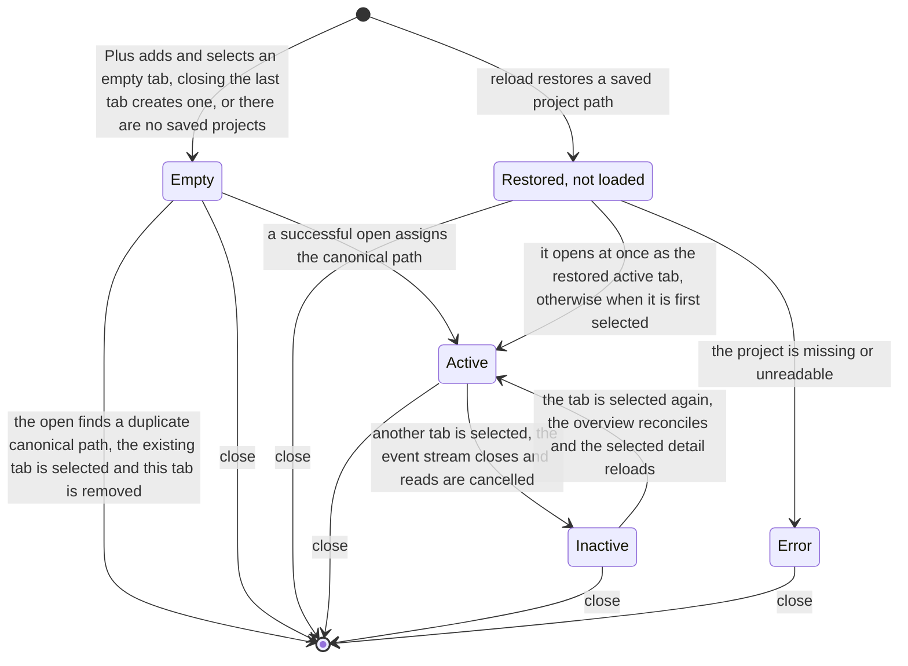

---
self_check:
  result: passed
  source: docs/artifacts/artifact-plane/specifications/project-tabs.md#hidden-tab-specification-self-check
---

# Project tab contract

## Governing knowledge

Artifact Plane requirements/project-tabs.md defines the outcome. Existing specifications/live-reload.md and specifications/lazy-loading.md govern freshness and deferred reads. The established artifact-driven dependency is unchanged.

## Workspace and identity

A workspace owns ordered tab records and one active tab ID. A record has a stable session ID and an optional canonical project path. Plus adds and selects an empty tab. Successful open assigns the canonical repository path returned by the existing overview API. A duplicate canonical path selects the existing tab and removes the redundant opening tab. Distinct worktree roots can have distinct tabs. Labels use the final path segment and append a shortest unique parent suffix when names collide; full paths remain in accessible descriptions or tooltips. The opened project root stays the tab identity while active worktree selection changes only its exploration context.

Close selects the next tab at the closed index, otherwise the preceding tab. Closing the last tab creates a new empty tab. Add, select, and close controls have accessible names. Tabs expose selected state and keyboard navigation using the tablist pattern; close controls must not be nested inside another button.

## Explorer isolation and lifecycle

Extract the existing explorer into a project-scoped component beneath a workspace shell. Each retained component owns its navigation, worktree, selection, filters, expansion, viewport, panels, runtime view, and asynchronous controllers. Switching hides the inactive explorer while preserving its session state; canvas dimensions must be reconciled when it becomes visible.

Only the active explorer performs automatic observation and deferred reads. Deactivation closes its event stream, cancels queued reads and detail/runtime requests, and invalidates asynchronous generations. Previously loaded data remains session-local and is stale until reconciled. Reactivation reconciles the overview through existing refresh behavior, retains valid selections, and reloads selected detail. It does not invoke initial-open resets. Existing lazy detail retention rules apply within each project. Inactive projects must not accumulate fresh detail or polling work.

### Hidden browser tab

A browser opens at most 6 HTTP/1.1 connections to one host, and each observing explorer keeps 2 event streams open: /api/repository/events and /api/runtime/events. A hidden browser tab must not keep them. The page is hidden when `document.visibilityState` is `hidden`.

- When the page becomes hidden, the active explorer closes both event streams and marks its observation disconnected. The top bar shows Stale with the existing reason.
- When the page becomes visible, the active explorer opens both streams again. The initial repository event requests a fresh overview and active section under live-reload.md, so the existing rule applies: Current shows only after that read succeeds with observation connected.
- Visibility changes only observation. Queued and running reads, edits, the route, selections and the top bar stay as they are. Requests that a hidden page starts still run.
- An inactive project tab stays closed whether the page is visible or hidden.

The server API does not change. Two visible windows keep 4 of the 6 connections; one shared stream for all tabs is out of scope.

Close unmounts the explorer and releases subscriptions, listeners, queued reads, runtime connections, and controllers. Late responses cannot affect another tab or a replacement tab. All request callbacks check owner generation and cancellation. Errors and freshness belong to the owning tab. No server API change or workflow registry is needed.

## Browser persistence

Use one application-specific localStorage key artifact-plane.project-tabs.v1. Its JSON value is {version: 1, projects: [absolutePath, ...], activeProject: absolutePathOrNull}. Persist only successfully opened canonical paths in tab order. Empty drafts and repository data are not stored. Writes follow successful opens, selection, and closes. Selecting an empty tab stores null as activeProject; on reload select the first restored project. With no saved projects, show one empty tab.

Validate version, object shape, absolute path strings, uniqueness, and active membership before creating project records. Ignore invalid records; unsupported or malformed top-level data falls back to an empty workspace. Ignore unknown fields. Use existing server path validation when reading a restored path. Paths are data, never markup. Catch unavailable storage, parsing failures, and quota errors; show a concise restoration warning while current-session exploration continues.

Restored inactive tabs load when first selected. The restored active tab opens through existing APIs and establishes fresh observation. A missing or unreadable project keeps its tab and path with an error and retry/open controls. Successful opens in another tab remain usable. Stored paths persist for retry until the user closes or replaces the tab. Separate browser windows read at startup and save their own workspace; live cross-window synchronization is excluded. Persistence is scoped to browser profile and origin, so port changes have separate workspaces.

The state diagram shows the states of one project tab, as the sections Workspace and identity, Explorer isolation and lifecycle and Browser persistence describe them. Each arrow is an event that changes the state of one tab. Active is the active tab with the active explorer. Inactive is hidden, keeps its session state, and its loaded data is stale until reconciled. Error keeps the tab and path with an error and retry and open controls. The end marker means that the tab is closed or removed: close unmounts the explorer and releases its resources, and the next tab at the closed index is selected, otherwise the preceding tab.

Source: artifact-plane:specifications/project-tabs.md, sections Workspace and identity, Explorer isolation and lifecycle and Browser persistence; derived one state per tab condition that the text names and one transition per stated event; current snapshot.

Gaps, as the source states them. The text does not name the state "Restored, not loaded"; the label uses the words "Restored inactive tabs load when first selected". The text also does not state:

- the state after retry or open in Error;
- whether an Empty tab becomes inactive when another tab is selected;
- an open failure from Empty;
- the meaning of "replaces the tab".

## Validation and impact

Exercise two independent repositories with equal artifact/task IDs, rapid switching, delayed responses, close during reads, runtime observations, automatic changes, and reactivation. Verify viewport retention and container resize behavior. Check localStorage round trips, corrupt input, missing projects, duplicate opens, and blocked storage. Run existing reader and browser suites and build. Inspect server stream cleanup and read-only fixture fingerprints. Retained per-project session state grows with open tabs; closing tabs releases it. No fixed total-memory guarantee is introduced.

## Specification self-check

Requirements map to workspace actions, lifecycle isolation, and persistence behavior. Current APIs remain compatible. Resource cleanup and stale response ownership are explicit. KISS and STE checks passed. No unresolved upstream gate or architectural ADR is required: the existing explorer remains the project boundary and browser storage carries only workspace preferences.

## Hidden-tab specification self-check

R11 maps to the Hidden browser tab rules: hidden pages close both streams, and the existing initial-event reload reconciles evidence before Current shows. R12 maps to the reply guard in explorer.md (Runtime and opening). The event API, routes and successful replies do not change, so no consumer artifact is affected and no ADR is needed. Flow repository-refresh gains the hidden-tab rule in its observe step and the new browser check; the other flows that name main.jsx, Runtime.jsx or http.js keep their steps. KISS: one visibility hook and a stringify-before-headers guard; no shared worker, leader election or HTTP/2. STE: each rule states one condition and one result. Representations: none added. No Specification blocker remains.
