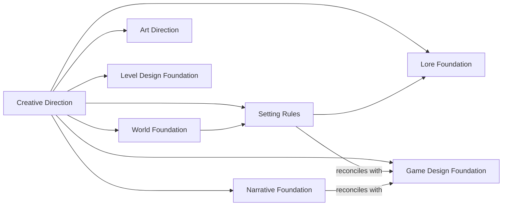

# Knowledge and Delivery Specification

## Knowledge contract

The bundle defines eight Core domains. The table names them in source order and says whether each domain is shared or conditional. The section names a condition only for the last three domains; a dash means that the text states no condition.

| Core domain | Shared or conditional | Applies when |
| --- | --- | --- |
| Creative Direction | Shared | — |
| World Foundation | Shared | — |
| Setting Rules | Shared | — |
| Lore Foundation | Shared | — |
| Narrative Foundation | Shared | — |
| Game Design Foundation | Conditional | games |
| Art Direction | Conditional | visual work needs it |
| Level Design Foundation | Conditional | spatial or encounter design needs it |

Source: story-driven:specifications/framework.md, Knowledge contract paragraph 1; derived one row per Core domain, in source order; current snapshot.

Narrative owns prose conventions and applicable interactive delivery conventions.

Five Content families own particular instances: World, Narrative, Gameplay, Visual, and Level. World owns fictional identity, including objects and powers; Gameplay owns their playable treatment. Lore Core owns canon policy, while particular historical facts belong to World and in-world accounts to Narrative. Each record links to authoritative facts rather than copying them.

Domain guides declare purpose, ownership, questions, inputs/outputs, prerequisites, stable constraints, evolution, and checks. Core contracts declare applicability and contradiction tests; Content records declare purpose, facts, links, uncertainty, and checks. Novel scenes specify viewpoint and resulting change; game scenes add applicable actions, conditions, state and consequences.

Work skeletons are Narrative Content. They link a specific premise, conflict, participant motivations, stakes, causal progression, outcomes and composition. A work can share canon without sharing a plot or outcome. Branch outcomes are work/playthrough-local until explicitly adopted into canon. Incompatible alternate canons require separate knowledge projects in this initial version.

## Dependency and change behavior

Prerequisites mean sufficiently defined applicable contracts, not completed encyclopedias. Cross-references and feedback are not execution edges. Creative Direction informs all domains; World informs Setting, which informs Lore. Narrative uses relevant shared rules. Game Design reconciles applicable actions with Setting and Narrative. Art and Level use relevant narrative, fiction and gameplay inputs. Concepts can start provisionally; final content requires its actual prerequisites.

The graph shows the stated relations between the eight Core domains. Each arrow goes from the domain that supplies input to the domain that receives it. An unlabelled arrow means "informs". The label "reconciles with" means that Game Design reconciles its applicable actions with the domain at the start of the arrow. Cross-references and feedback are not execution edges, and the graph does not show them.

Source: story-driven:specifications/framework.md, Knowledge contract (domain names) and Dependency and change behavior paragraph 1; derived one node per Core domain and one edge per stated informs or reconciles relation; current snapshot.

The text does not name the supplying domains of two relations, so the graph does not draw them:

- "Narrative uses relevant shared rules."
- "Art and Level use relevant narrative, fiction and gameplay inputs."

Objective truth, testimony, character belief, audience knowledge, and game state are separate. Review maturity is not truth. A rule conflict returns to its Core owner, followed by review of referenced dependents. Unknowns stay explicit; approvals remain available in conversation or Git rather than a status database.

## Authoring interface

The workflow is intent → sufficient Core → linked story skeleton → representative slice → revision → handoff, with feedback and entry from existing material. Coordinator, architect, and author roles can run in one session or delegate independent work after inputs exist. Each skill loads the bundled KISS and writing skills, applying them to technical instructions rather than creative prose.

Four Markdown templates supply creative brief, Core contract, Content entry, and work skeleton. Domain guides specialize the questions. Consumer guidance defaults authored knowledge to docs/story-knowledge, distinct from adopted docs/story-driven. Agent registration is manual and optional; adoption does not modify consumer instructions or harness files.

## Bundle and public delivery

Maintain reusable sources at src/archs/story-driven. Embed foundation, methodology, execution, templates, examples, and adoption guidance; mount the existing utility skills under required-skills using the existing embedded-filesystem pattern. No second maintained utility copy or new runtime is introduced.

Register story-driven in src/archs/catalog.go, preserving the default artifact-driven. Existing --arch, --list, --output and --dry-run flags and safe copy behavior apply unchanged. CLI wording recognizes knowledge architectures. The website continues to derive documentation from src; expose the new architecture through navigation and repository documentation.

Links are portable file references with existing targets and valid anchors. A child cannot reference an ancestor document, including in task and version records; sibling links are allowed. Templates are self-contained and describe consumer paths as code rather than dangling file links. External citations support design rationale but are not required to operate the framework.

## Example and validation contract

The Sealed Archive is explicitly illustrative, with shared characters, place, event, object and applicable rules. Its novel outline and game quest reuse those records. Include false testimony, reveal order, optional lore, environmental evidence, consequential outcomes, a traversal-free gameplay contract, and a concrete Core-revision impact review. Examples include their own review findings; they never assert artistic quality or implemented game behavior.

Automated checks verify the filesystem bundle, Markdown targets/anchors and hierarchy, skill discovery metadata, complete adoption, selection/listing, dry run, repeated adoption and conflict protection. Go tests/vet and website production build validate integration. Independent creative-role exercises inspect the novel-only path and revision behavior.

## Specification self-check

The model resolves object versus gameplay ownership and policy versus historical facts. Interfaces require no new CLI flags, registry or workflow database. Required guidance is shipped, medium inputs are conditional, and upstream ADD artifact changes are unnecessary. KISS and clear technical writing were applied; no Specification blocker remains.
