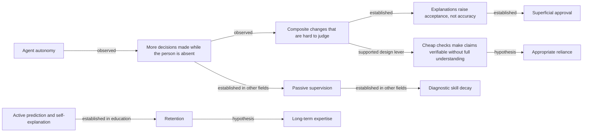

# Human cognitive support in ADD and Artifact Plane: investigation and design

Status: research record, 19 October 2026. This file is an investigation, not a requirement, specification or decision. It changes no artifact. It is the input for a later unit of work. No change record exists for it yet, so this directory has no unit brief.

Report page: https://claude.ai/artifact/FRuCkmRi5aYBcq5V1nFtdF
Interactive prototype: https://claude.ai/artifact/2ZBFnXHdDD6gRkqc32b7rz

## Scope and method

**Question.** AI agents investigate, decide and change this repository faster than a person can follow. How can ADD and Artifact Plane help a person understand, challenge and govern that work, and keep and grow their own technical judgment, without new manual documentation, more approval gates or a second source of truth?

**Baseline.** Main at `d931d07` (18 October 2026): ADD 2.8.1, Artifact Plane 1.19.0, Story-Driven 1.1.1. All three versions are established. No change is open.

**Method.**

1. Three read-only surveys of the ADD bundle (`docs/artifact-driven`), the Plane implementation (`apps/artifact-plane`) and the project knowledge (`docs/artifacts`), with file and line evidence. Section A condenses them.
2. A targeted literature search on cognitive load, expertise, automation bias, explanation, reliance, learning techniques, agent transparency, model faithfulness and AI-assisted software work. Ten headline figures were checked against the primary abstract or the authors' page. Section B lists the findings with an evidence label.
3. Three independent designs from the same evidence: A derive-only, B evidence-linked claim records, C adaptive workbench. Each design critiqued the other two. Section D compares them.
4. A recommended architecture (section E), an interactive prototype on real records of this repository (section F), a roadmap (section G), measures and experiments (section H), and open questions with rejected ideas (section I).

**Evidence labels.** E: established (meta-analysis, replicated or preregistered experiment). M: moderate (one well-run study, or observational). W: weak (preprint, survey, practitioner report). "Hypothesis" marks a link that no study in this list tests.

**Limits of this investigation.** No user study was run. The prototype shows the design; it does not measure it. Most learning evidence comes from education, not professional software work. Section H describes the measurements that would test the design.

## A. Current state

### A1. What ADD defines

| Topic | What exists | Source |
| --- | --- | --- |
| Phases | Requirement, Specification, Plan, Implementation, Version. ADR work is part of Specification. | `docs/artifact-driven/01-foundation/artifact-model.md:105-115` |
| Roles | Coordinator, product owner, technical lead, implementer, plus the required skills `kiss` and `asd-ste-100`. | `docs/artifact-driven/03-execution/README.md:16-31` |
| Self-checks | Done by the author of each phase. "No separate reviewer agent is required." | `docs/artifact-driven/02-methodology/workflow.md:29,39` |
| Human gates | Plan approval (mandatory), renewed approval after a material change, version level confirmation, team PR review and merge. | `06-guidelines/working-with-ai.md:56`; `add-coordinator/SKILL.md:30,52,56` |
| Approval | "Not a file fact. Authorization comes from the user." Approval registries and workflow state registries are forbidden. | `artifact-model.md:93`; `workflow.md:80`; `03-execution/README.md:64` |
| Check evidence | Task DoD checklist and Evidence section (mandatory). Optional `evidence_records` with `id`, `method`, `result` (passed, failed, incomplete), `source`. Optional `self_check`. | `06-guidelines/evidence-records.md:9-22` |
| Evidence basis | Flow supports carry `basis`: documented, static, observed or inferred. "It describes the evidence basis, not an approval or verified-execution state." | `06-guidelines/system-flows.md:13` |
| Change impact | Tiers changed, direct, transitive, potential, unresolved. Verify and Investigate lists. An explanation record with ordered strength labels. A coverage statement. Numeric confidence is rejected. | `docs/artifacts/artifact-driven/specifications/change-impact.md`; ADR 012 |
| Decisions | ADRs record context, alternatives, chosen option, reasoning and consequences. No front matter, no status, no assumptions field. Newer ADRs use option tables with "Rejected." and "Selected." verdicts. | `06-guidelines/writing-artifacts.md:32` |
| Graph semantics | The artifact DAG, the task DAG and system flows are separate. Flow transitions create no prerequisites. | `02-methodology/dependencies.md:5,54,82` |
| Visual knowledge | Principles P1 to P6, a selection guide, rules for when not to draw. Progressive disclosure is a recommendation with partial evidence. | `01-foundation/visual-knowledge.md`; `06-guidelines/visual-representations.md` |

**Gaps.** Each gap was searched for and not found.

- No per-claim label for uncertainty. "Confidence" and "risk" have no hits in the bundle.
- No format or lifecycle for assumptions. The bundle says "Distinguish confirmed facts from assumptions" (`writing-artifacts.md:24`) but gives no place to do it.
- No structured place for open questions outside flow `gaps` and `exclusions` and the unit `flow_assessment`.
- One plan approval mixes two questions: "is this the right goal?" and "is this technically correct?" (`working-with-ai.md:56`).
- No evidence record says who did a check. A reader cannot tell a person's check from an agent's record.
- "Present the concrete plan" has no presentation format.
- No learning or retrospective loop.

### A2. What Artifact Plane implements

| Capability | What exists | Source |
| --- | --- | --- |
| Architecture | Loopback Node 24 server and React 19 app. Reads Git and Markdown on demand. Three private SQLite indexes outside repositories. No workflow store. | `server/http.js`; ADR 002 |
| Change-context packet | Baseline, changed records with fingerprints, governing sources, impact candidates and tiers, evidence (`approval: 'Approval not verified by this reader.'`), excerpts, five fixed limit sentences, unresolved facts, freshness and completeness. | `server/change-review.js:14,149` |
| Impact service | Origins: path, element, flow, step, model, commit, range, diff. Typed reverse propagation. Sections changed, direct, transitive, steps, verify, investigate, potential, unresolved. Declared and computed flows compared. Up to three typed paths per entity. | `server/impact.js:100-264` |
| Impact page | Asks by path or commit. Tier toggles, filters, a graph of at most 60 nodes, coverage. Entry points on change, document and flow pages. | `src/pages/ImpactPage.jsx` |
| Editing | 36 validated operations through one writer, with undo. `evidence.record`, `selfcheck.record`, `unit.evidence.record` and `publication.record` already exist. | `server/knowledge-operations.js` |
| Agent access | MCP tools for flows, change review, context packets and impact. Write operations only with `--allow-writes`. | `server/flow-mcp.js` |
| Agent observation | Codex lifecycle hooks store event kinds and tool names only. No transcripts, inputs or outputs. The event timeline components exist but are not rendered. | ADR 006; `src/Runtime.jsx:35-37` |
| Pages | Work, artifact, document, change, unit, flow, source, discover, recorded executions, impact. Light, document-first style from 1.17.0. | `src/main.jsx:35-36` |
| Validation | `scripts/validate-knowledge.mjs` (run by hand, not in CI). Nine ground-truth impact cases. 365 Node tests, 14 browser specs. | `test/fixtures/impact-cases.json` |

### A3. What the existing data can answer

| Question a reviewer asks | Today | Gap |
| --- | --- | --- |
| Which entities did this change touch? | Yes: packet records and impact `changed` with symbols and sections. | JavaScript symbols only. |
| Which flows and steps does it affect? | Yes: impact `steps`. | Declared relationships only. |
| Which tests should run? | Partly: impact `verify`. | No link from an element to tasks or DoD. |
| What is not covered? | Partly: flow gaps, coverage statement, frontier, unresolved, declared versus computed flows. | No measured code coverage. |
| Which references do not resolve? | Yes. | None. |
| Which decisions belong to this change? | Partly: added or modified ADRs. | No status, no assumptions, no link to the claims they rest on. |
| Which evidence belongs to which task? | Yes. | No actor. |
| What did the agent do? | Partly: event kinds and tool names. | No results; the timeline is not shown. |
| Which hypotheses were tested? | No. | Prose only, when written at all. |
| Which assumptions does the change rest on? | No. | Prose sections in three Plane requirements only. |
| How certain is each claim? | Partly: many state labels (unknown, inferred, partial, stale). | No per-claim model. |

### A4. What the repository history shows

- 38 numbered pull requests merged in six days, 13 to 18 October 2026. Sixteen commits landed on 13 October and six on 18 October.
- Four unit briefs record failed or incomplete criteria for versions that are established: `add-agent-efficiency` (measurements failed), `evidence-and-usability` (one failed, one incomplete), `model-explanations` (integration incomplete) and `plane-authoring-workbench` (effort incomplete).
- Artifact Plane 1.17.0 shipped with the owner-acceptance DoD item unchecked (`changes/change-workbench-redesign/tasks/08-integration-version.md:27`).
- Five Plane flows still say "current integrated validation remain pending" for work delivered in 1.14.0, for example `artifact-plane/specifications/flows/change-review.md:184`.
- `AGENTS.md` names `legacy-conversion` as the current unit of work. That unit was delivered in pull request 30.
- The hidden-tab bug fix records a negative control and a limit. Its README states a measurement (one read took 0.33 s) that ruled out slow reads. No record says that this was a tested hypothesis.

These facts are not failures of a person. They show that a fast agent pipeline produces correct records and also unchecked residue, and that the current pages do not bring the residue to anyone's attention.

## B. Research findings

### B1. Explanation, reliance and verification

| Finding | Label | Source | Implication for this product |
| --- | --- | --- | --- |
| Explanations made people accept AI advice more often, whether it was right or wrong. Team accuracy did not rise above AI support alone. | E | Bansal et al., CHI 2021 | A longer agent explanation is not a review aid. Show it after the check, not instead of it. |
| People choose to rely on AI by cost and benefit. Explanations reduce overreliance only when they lower the cost of verifying. N = 731 in five studies. | E | Vasconcelos et al., CSCW 2023 | Each consequential claim needs the cheapest check a person can run. |
| Explanations help only to the extent that they let a person verify the answer. Most decision tasks do not allow that. | M | Fok and Weld, AI Magazine 2024 | Software is unusual: tests, diffs, reproductions and invariants make many claims verifiable. Use that property. |
| Longer explanations raised user confidence even when the extra length did not raise accuracy. Explanations matched to model confidence narrowed the gap. | M | Steyvers et al., Nature Machine Intelligence 2025 | Keep each statement to one line. Do not reward length. |
| First-person uncertainty ("I'm not sure, but…") lowered agreement with wrong answers and raised accuracy. N = 404, preregistered. | E | Kim et al., FAccT 2024 | State uncertainty in words on the claim itself. Do not hide it in a badge. |
| Cognitive forcing (answer first, wait, explanation on demand) reduced overreliance more than explanations. People liked these designs less. The benefit was larger for people high in need for cognition. | E | Buçinca, Malaya and Gajos, CSCW 2021 | Prediction before reveal works but costs satisfaction. Make it optional and rare. |
| Across 106 experiments and 370 effects, human and AI together did worse than the better of the two alone (g = −0.23, CI −0.39 to −0.07). Losses were in decision tasks; gains were in creation tasks and when the human was better than the AI. | E | Vaccaro, Almaatouq and Malone, Nature Human Behaviour 2024 | More human decisions do not raise quality by themselves. Ask for judgment only where the person adds information. |
| Appropriate reliance can be measured as relative AI reliance plus relative self-reliance. | M | Schemmer et al., IUI 2023 | Measure correct acceptance and correct rejection, not approval rate. |
| Higher confidence in AI went with less critical thinking. Higher self-confidence went with more. Critical thinking moved toward verification, integration and stewardship. 319 knowledge workers, self-report. | M | Lee et al., CHI 2025 | The review page should support verification and integration, which is where thinking now happens. |
| Engineers find it hardest to know whether a change is complete and consistent and what risk it poses to other components. They want composite changes split into parts. | E | Tao et al., FSE 2012 | Completeness, consistency and risk to other components come first on the page. |
| Developers form about two hypotheses per defect. An early correct hypothesis predicts success. Offering hypotheses made success six times more likely; offering fault locations did not help. N = 20. | M | Alaboudi and LaToza, VL/HCC 2020 | For debugging, show the hypotheses and how each was decided, not only the fix location. |

### B2. Faithfulness and independence of model output

| Finding | Label | Source | Implication |
| --- | --- | --- | --- |
| Reasoning models revealed the hints they used in their chain of thought often in fewer than 20% of the cases where they used them. Unfaithful traces were longer. | E | Chen et al. (Anthropic), 2025, arXiv 2505.05410 | A generated explanation is a claim about a decision, not a record of how it was made. Never label it otherwise. |
| LLM evaluators recognize their own output and rate it higher. | E | Panickssery, Bowman and Feng, NeurIPS 2024 | A second model's agreement is not independent evidence. |
| Of patches that pass the SWE-bench Verified tests, 7.8% fail the full developer test suite. 29.6% behave differently from the reference fix; 28.6% of those are certainly wrong. Reported resolution rates were inflated by 6.2 percentage points. | M | "Are 'Solved Issues' in SWE-bench Really Solved Correctly?", ICSE 2026, arXiv 2503.15223 | Passing agent-chosen tests is weak evidence. Prefer tests that fail before the fix and the full suite. |
| LLM root-cause analysis on 48,000 simulated failures had low accuracy and pervasive reasoning failures. Some failure types predict a wrong answer. | M | Riddell et al., FORGE 2026, arXiv 2601.22208 | A plausible root cause needs a demonstrated causal check. |
| LLM-generated unit tests often contain Assertion Roulette and Magic Number smells. | M | Ouédraogo et al., arXiv 2410.10628 | An AI test is evidence only after it is shown to fail without the fix. |

### B3. Automation bias, situation awareness and skill decay

| Finding | Label | Source | Implication |
| --- | --- | --- | --- |
| Complacency and automation bias are failures of attention and of combining information. Workload, trust and system reliability moderate them. | E | Parasuraman and Manzey, Human Factors 2010 | Lower the attention cost of a check; do not ask for vigilance. |
| When a wrong AI category was suggested, radiologists' correct ratings fell from about 80% to 20% (inexperienced), 25% (moderate) and 46% (very experienced). | M | Dratsch et al., Radiology 2023 | Experience reduces but does not remove the effect. Expert users also need checks. |
| Operators of automated systems lose situation awareness through passive processing. More operator control reduces the loss. | E | Endsley and Kiris, Human Factors 1995 | Keep the person active at a few points of real decision. |
| Airline pilots kept manual handling skills but lost cognitive skills such as tracking position and recognizing failures. The loss went with mind wandering while automation flew. | M | Casner et al., Human Factors 2014 | The skill at risk in software is diagnosis and judgment, not typing code. |
| Adenoma detection in colonoscopy without AI fell from 28.4% to 22.4% after clinicians used AI routinely. Observational, before and after. | M | Budzyń et al., Lancet Gastroenterology and Hepatology 2025 | Skill can decay within months of routine assistance. |
| Clinicians override 49% to 96% of drug safety alerts. Causes: low specificity, unclear content, workflow interruption. | E | van der Sijs et al., JAMIA 2006 | Few, specific prompts. A generic "are you sure" becomes a reflex. |
| Situation-awareness-based transparency: level 1 goals and actions, level 2 reasoning and constraints, level 3 projections and uncertainty. More transparency improved operator performance. | M | Chen et al., ARL-TR-6905, 2014 | Order the change brief by these levels: what, why, what next and how sure. |

### B4. Learning, expertise and AI assistance

| Finding | Label | Source | Implication |
| --- | --- | --- | --- |
| Guidance that helps novices becomes redundant or harmful for experts (expertise reversal). Worked examples help early and should fade. | E | Kalyuga et al., Educational Psychologist 2003; Renkl and Atkinson 2003 | Explanations must be optional and must fade. Do not show the same help forever. |
| Practice testing and distributed practice have high utility. Self-explanation and elaborative interrogation have moderate utility. Rereading and highlighting have low utility. | E | Dunlosky et al., Psychological Science in the Public Interest 2013 | Reading a long summary teaches little. Retrieval and prediction teach more. |
| Self-explanation prompts: g = 0.55 across 64 reports. | E | Bisra et al., Educational Psychology Review 2018 | A short "why was X rejected?" prompt has support. |
| Making a prediction before seeing the answer raises curiosity; wrong predictions are remembered better. | M | Brod, Psychonomic Bulletin and Review 2021 | Predict before reveal is the strongest cheap learning lever. |
| Problem solving before instruction helps when the design has fidelity. 53 studies. | E | Sinha and Kapur, Review of Educational Research 2021 | Let the person attempt the diagnosis first, when they choose to. |
| Deliberate practice explains 26% of performance variance in games and under 1% in professions. | E | Macnamara, Hambrick and Oswald, Psychological Science 2014 | Do not promise that practice at work builds expertise. Treat it as a hypothesis. |
| People mistake access to information for their own understanding; searching inflates estimates of internal knowledge. | E | Fisher, Goddu and Keil 2015; Rozenblit and Keil 2002 | A person who read an agent summary will overrate their understanding. Measure, do not ask. |
| In a randomized trial with 52 mostly junior developers learning an unfamiliar library, the AI group scored 50% and the hand-coding group 67% on a quiz (d = 0.738, p = 0.01). The AI group was not significantly faster. The largest gap was on debugging questions. Developers who asked conceptual questions scored 65% or more; developers who delegated scored under 40% (association only). | E | Anthropic, "How AI assistance impacts the formation of coding skills", 2026, arXiv 2601.20245 | Delegation harms skill formation most in debugging. Conceptual questioning is the pattern to support. The study is short term and used a sidebar assistant, not an agent. |
| High school students with unguarded GPT-4 practice scored 17% lower on an unaided exam. A guardrailed tutor that gave hints prevented the harm but gave no gain. About 1,000 students. | E | Bastani et al., PNAS 2025 | Guardrails prevent harm; they do not create learning by themselves. |
| A scaffolded AI tutor gave larger learning gains than an active-learning class. 194 students, crossover. | E | Kestin et al., Scientific Reports 2025 | Scaffolding, not access to AI, is the active ingredient. |
| Developers fell into self-sufficient, understanding-gated and AI-steered personas. AI-steered developers finished fast with little comprehension. Averages hid the difference. 21 developers. | M | Alakmeh et al., ICPC 2026 | Do not judge the design on averages. |
| Experienced open-source developers took 19% longer with AI tools while they believed they were 20% faster. 16 developers, 246 tasks. A 2026 follow-up with 57 developers found estimates whose intervals include zero; METR calls that signal unreliable because of selection effects. | E, W | METR 2025; METR February 2026 | Self-reported speed and understanding are not valid measures. |
| Programmers spent 22.4% of session time verifying suggestions and 34.3% checking and editing them. | M | Mozannar et al., CHI 2024 | Verification already dominates the time. The design must make it cheaper, not longer. |
| After adopting agents, pull request descriptions grew 76.8%. Reviews became faster and less detailed, but equally so in control repositories. | M | Hamza et al., ESEM 2026 | More agent text is already arriving. Do not add more. |

### B5. What the evidence does not show

- No study shows that any review interface builds long-term software expertise. Section H proposes how to measure it.
- The learning evidence is strong in education and associational in professional software work.
- No study measures how a person reviews ADD knowledge specifically.
- "Comprehension debt" (arXiv 2604.13277, student diaries) and "cognitive debt" (Kosmyna 2025, EEG, contested) are useful words with weak evidence. This record does not rely on them.

## C. Problem model

The chain in the brief is agent autonomy, decision complexity, human understanding, verification capability, learning opportunity and long-term expertise. The evidence supports some links and not others.



| Link | Status | Evidence |
| --- | --- | --- |
| Autonomy raises the number of decisions taken while the person is absent. | Observed | METR 2026 (developers work on other tasks while agents run); this repository (38 PRs in six days). |
| Composite changes are hard to judge. The hardest needs are completeness, consistency and risk to other components. | Observed | Tao 2012; Alakmeh 2026 |
| Explanations raise acceptance, not accuracy, unless they lower the cost of a check. | Established | Bansal 2021; Buçinca 2021; Vasconcelos 2023; Steyvers 2025 |
| A person can verify a claim without understanding all of it when an observable property exists: a test that fails before the fix, a reproduction, an invariant, a diff. | Supported design lever | Fok and Weld 2024; SWE-bench correctness study |
| Generated reasoning is not a faithful record. A second model is not independent. | Established | Chen 2025; Panickssery 2024 |
| Passive supervision erodes the diagnostic skills needed when automation is wrong. | Established in aviation and medicine; moderate in software | Endsley and Kiris 1995; Casner 2014; Budzyń 2025; Anthropic 2026 |
| Active engagement improves retention. | Established in education; associational in software | Dunlosky 2013; Bisra 2018; Brod 2021; Anthropic 2026 |
| People misjudge their own speed and understanding. | Established | METR 2025; Fisher 2015; Lee 2025 |
| Many non-specific gates produce reflexive approval. | Established in clinical systems; hypothesis for ADD | van der Sijs 2006 |
| Work-embedded practice builds long-term expertise. | Hypothesis | Macnamara 2014 sets its limits. No longitudinal software evidence. |

**Consequences for the design.**

1. Understanding every step is not the target. Verifiable consequential claims are the target.
2. The scarce resource is the cost of a check, not the amount of explanation.
3. Learning support must target diagnosis and judgment, because those skills decay first.
4. Every measure must be objective. Self-report fails in this domain.

## D. Design alternatives

Each alternative was designed independently against the same constraints.

| | A. Derive-only | B. Evidence-linked claims | C. Adaptive workbench |
| --- | --- | --- | --- |
| Idea | Change no ADD format. The Plane derives a review section from Git, the packet, impact, evidence records and ADR prose. Agents follow prose lead-ins such as "Hypothesis rejected:", "Negative control:" and "Limit:". | Add one optional front-matter list, `claims`, to existing records. Agents record only consequential claims, each with a status that needs evidence, a basis and the cheapest check. The Plane derives a change brief and a verification ladder. | Derive a risk class from the diff and the indexes, and change how the Plane asks for attention. Add optional prediction, self-explanation and "new here" notes. Keep personal signals in the browser. |
| Stored | Nothing new | `claims` in existing front matter | Nothing new; reuses B's claims when present |
| Answers completeness and consistency | Partly; prose matching is fragile | Yes: undecided impact and unchecked claims are computable | Same as its data source |
| Separates a person's check from an agent's record | No | Yes: `verified_by` comes from the write channel | Only with B |
| Shows tested hypotheses | Only when agents use lead-ins | Yes | Only with B |
| Learning potential | Low | Moderate | Highest, with education-grade evidence only |
| Cost (estimate) | About 900 lines of Plane code, skill prose | About 800 lines of Plane code, about 60 lines of bundle prose, one ADR | About 1,400 lines of Plane code |
| Maintenance | Prose patterns drift; ADR 009 already rejected regular-expression readers | One validator beside `evidence_records` | Risk thresholds and conventions drift |
| Main failure modes | Blind to hypothesis versus conclusion, to person versus agent checks and to dismissed potential impact | Claim inflation; self-verification; stale claims; drift between claim text and code | Nagging; prediction fatigue; personal signals that turn into competence scores; agents splitting changes to lower the class |
| Verdict | Phase 0 of B | Core | Optional layer on B, kept only if measured |

**Why B is the core.** A breaks down at exactly three points: it cannot tell a tested hypothesis from a conclusion, a person's check from an agent's record, or a dismissed impact item from an ignored one. Those three are the reviewer's hardest needs (Tao 2012; Alaboudi and LaToza 2020). B closes them with one optional list that agents write and people read. C's interaction changes are useful, but C needs B's records to have anything precise to ask about.

**Why B is not a state machine.** A claim's `status` is an evidence label, like `evidence_records.result`. A status other than `open` needs an evidence source. No workflow reads it, no phase depends on it and nothing aggregates it into a registry.

## E. Recommended architecture

### E1. Principles

1. **Verification before explanation.** Each consequential claim carries the cheapest check a person can run: a test that fails before the fix, a command, an invariant, a counterexample or a measurement to repeat.
2. **Claims are not records.** Separate observed actions, recorded experiments, generated narrative, implementation changes, independent checks and unknowns. Never present generated text as the model's reasoning.
3. **Lower the cost of a check, not the length of the text.** Show one causal path, one small subgraph, one failing test.
4. **Few, specific prompts.** Ask for judgment only where the person adds information. Goal approval and correctness verification are separate questions.
5. **Active when it pays, optional always.** Prediction and self-explanation appear only for consequential decisions and tested hypotheses. They can be skipped and they fade.
6. **No competence scores.** Use observable, local signals ("you have not opened this flow in this repository"), never inferred ability.
7. **Minimal durable knowledge.** Store only consequential claims in existing records. Derive everything else. Agent transcripts stay outside Git.
8. **The question chooses the representation.** No whole-graph view by default.
9. **Measure understanding, not satisfaction.**

### E2. Layer A: the ADD extension

One optional front-matter list in existing records. It adds no phase, role, artifact, gate or mandatory field.

**Where.** Requirements, specifications, decisions, `tasks/README.md`, task files and unit briefs. Not in version records, identity records, flow records or the change README.

**Fields.**

| Field | Rule |
| --- | --- |
| `id` | Matches `[a-z0-9][a-z0-9-]*`; unique in the file. |
| `kind` | `decision`, `assumption`, `hypothesis`, `root_cause`, `unknown` or `risk`. |
| `statement` | One assertion in one sentence. Not a DoD item, requirement or summary. |
| `status` | `open`, `supported`, `verified`, `refuted` or `superseded`. Describes evidence, never approval. |
| `basis` | `documented`, `static`, `observed` or `inferred`, with the meaning of the flow support vocabulary. |
| `evidence` | List of sources under the `evidence_records` source rule. Required for `supported`, `verified` and `refuted`, and for `basis: observed`. |
| `check` | The cheapest verification, as inert text. Expected for `decision`, `root_cause` and `assumption` unless refuted or superseded. |
| `verified_by` | `person` or `agent`. Required with `verified`; forbidden otherwise. Set by the write channel, never by input. |
| `rejected` | `decision` only: list of `{option, reason}` with one reason each. |
| `risk_if_wrong` | Optional, one line. |
| `about` | Optional list of entity IDs or tracked paths that the claim concerns. It links a claim to impact items; it creates no dependency. |
| `superseded_by` | Required with `superseded`; a claim ID in the same file. |

**When to record a claim (the consequential rule).** Record a claim only when at least one condition is true:

1. It selects between options that change a contract, a flow, a dependency or files outside the task's scope.
2. If it is wrong, a DoD item, an acceptance criterion or a declared flow is wrong.
3. It dismisses a computed impact item or a tested hypothesis.
4. It names a limit that the version ships with.

**Verification rule.** `verified` is never a checkbox. The `claim.verify` operation needs the observed result as text. It writes the result as a section under the document's Evidence heading, sets `evidence` to that section and sets `verified_by` from the channel: the browser is a person, MCP is an agent. A `verified` claim without a resolving source is an error.

**Illustrative claim** (from the hidden-tab bug, written as the agent would have recorded it; shortened paths):

```text
claims:
  - id: slow-reads
    kind: hypothesis
    statement: Document reads are slow on the server.
    status: refuted
    basis: observed
    evidence: [docs/artifacts/artifact-plane/changes/change-hidden-tab-streams/tasks/01-hidden-tab-streams.md#slow-reads]
    check: Time one document read on the same server; it took 0.33 s.
  - id: cause-connections
    kind: root_cause
    statement: Three tabs with two event streams each use all six browser connections to the host, so reads wait and time out.
    status: supported
    basis: observed
    evidence: [docs/artifacts/artifact-plane/changes/change-hidden-tab-streams/tasks/01-hidden-tab-streams.md#evidence]
    check: With the 1.18.0 main.jsx the two hidden-tab browser tests fail; with the fix they pass.
    about: [artifact-plane:repository-refresh:observe, apps/artifact-plane/src/main.jsx]
```

**Bundle pages that change** (one minor ADD version):

- `06-guidelines/evidence-records.md`: a Claims section with the rules above.
- `06-guidelines/writing-artifacts.md`: one sentence: each rejected ADR option carries one reason.
- `01-foundation/artifact-model.md`: one row in phase evidence.
- `06-guidelines/working-with-ai.md`: in Review the Plan, read the open claims first; approve the goal and scope; verification is a separate act.
- `add-coordinator`, `add-technical-lead`, `add-implementer` skills: the consequential rule, one paragraph each.
- Project knowledge: `artifact-driven/specifications/evidence-records.md` and a new ADR with the three alternatives.

### E3. Layer B: what agents produce

| Activity | Where | What |
| --- | --- | --- |
| Research and architecture | ADR or specification | An options table with one reason per rejected option; one `decision` claim; the `assumption` claims it rests on; `unknown` claims for what the analysis did not cover. Measurements labeled as prototype or delivery evidence. |
| Debugging | Task | Every tested `hypothesis`, refuted ones included, with the measurement that decided it; one `root_cause` whose check is a test that fails before the fix; a negative control in Evidence; limits as `unknown` or `risk`. |
| Planning | `tasks/README.md` | The impact Verify list turned into DoD checks; plan `assumption` claims such as disjoint file scopes. |
| Implementation | Task | `evidence_records` with negative control and limit lines; local `decision` and `assumption` claims; impact rerun on the branch before the self-check. |
| Coordination | Unit brief | One `assumption` that dismisses reached-but-not-declared flows, with `about` naming them. |

Agents write claims through `claim.record` and `claim.verify`, which follow the same validated writer as `evidence.record`. The existing `apply_knowledge_operation` MCP tool exposes them. Expected agent cost: three to seven claims per phase document, about 150 tokens each.

**Detection derived from claims, impact and evidence.**

| Diagnostic | Severity | Rule |
| --- | --- | --- |
| `invalid-claim` | error | Shape, values, duplicate ID, or a status without its required field. |
| `claim-evidence-missing` | error | A required evidence source does not resolve or its section is empty. |
| `claim-evidence-conflict` | error | A supported or verified claim cites evidence whose record is failed or incomplete. |
| `claim-check-missing` | warning | An open or supported decision, root cause or assumption has no check. |
| `claim-unverified-at-version` | warning | A version record names a change whose decision, root cause or assumption claims are still open or supported. |
| `claim-list-long` | warning | More than ten claims in one file. |
| `impact-undecided` | derived | A potential, reached-but-not-declared or unresolved impact item that no claim is `about`. |
| `claim-stale` | derived | A file named in `about` or `evidence` changed after the claim's file last changed. |
| No check by a person | derived line | No claim in the change has `verified_by: person`. |

Semantic contradictions between a claim and the code are not detected. The guideline states this limit.

### E4. Layer C: Artifact Plane

**Change brief.** One new section at the top of the change page, above the plan. It answers seven questions in this order. Each answer is one line that expands in place. Empty answers are hidden.

| Question | Data | Shown as |
| --- | --- | --- |
| What changed? | Packet records; impact `changed` with symbols and sections | Records grouped by task; changed files that no task names are listed as "not in any task scope" |
| Why? | Change README reason; `decision` claims with `rejected` | Reason paragraph; each decision with its rejected options folded |
| What is affected? | Impact tiers; declared and computed flows | Tier counts; flows reached but not declared, each with the claim that dismissed it or "undecided" |
| What should I care about? | Open decisions, open root causes, assumptions with `risk_if_wrong`, failed or incomplete evidence, `impact-undecided` | At most seven rows, ranked by kind, then impact tier, then strength |
| What do I need to understand? | Claim statements; affected steps; entities you have not opened in this repository | One line per claim; "New here?" links to the owning document |
| What can I verify? | Claim `check`; impact Verify list; negative controls | Copyable commands and test names, each with its ladder step and "Record my check" |
| What needs my decision? | Open decisions; undecided impact; recorded limits; the existing plan and version gates | Separate actions: accept the goal, record my check, ask for an independent check, open a correcting change |

**Verification ladder.** Every claim and check row shows exactly one step. Higher steps are stronger.

| Step | Meaning | Source |
| --- | --- | --- |
| Not analyzed | Named but not investigated | `unknown` claims; coverage `not_analyzed` |
| Inferred | Concluded without an observation | `basis: inferred` |
| Explained | Text written by the agent | Rationale, rejected reasons, README prose |
| Observed activity | The agent ran tools | Codex observer event kinds and tool names; never proof of a result |
| Recorded experiment | The agent recorded a check and its result | `basis: observed` with evidence; `evidence_records` |
| Fact from Git | The diff and the computed impact | Git, impact service |
| Re-checked by an agent | A second agent check with its own detail; not independent | `verified_by: agent` |
| Checked by a person | A person ran the check and recorded the observed result | `verified_by: person` |

The ladder never uses the word "verified" for an agent record. A test written by the same agent counts as a recorded experiment until a failing-before run is recorded.

**Representation by question.**

| Situation | Representation | Reuses |
| --- | --- | --- |
| Debugging | Hypothesis ledger, then one causal path, then the regression test | Claims; impact paths |
| Architecture choice | Options table with criteria and one reason per rejected option; the assumptions behind the choice | ADR table; claims |
| New flow | Steps of the new flow; contracts touched; declared versus computed flows; Verify list | Flow diagram; impact |
| Impact review | Tiers with the relationship path per item; coverage | Impact page |

Graphs open on request only and show the subgraph that the claim concerns.

**Risk classes (phase 2).** The class is derived from the diff and the indexes, never from agent text. The highest triggered class wins. The brief names the triggering signals; it shows no number.

| Class | Triggers | Interaction |
| --- | --- | --- |
| Routine | Code or tests only; every affected step has a test; no unresolved item | No prompt. The brief exists. |
| Notable | Requirement or decision text changed; transitive cross-artifact consumers | One line on the work page change card. |
| Judgment | A contract or flow specification changed; direct consumers in another artifact; an unresolved prerequisite; an affected step without a test; declared and computed flows differ | One question block at the existing plan or version gate. No new dialog. |
| Independent check | A contract was removed or renamed; tests were removed or skipped; CI files changed; a version is prepared with unchecked DoD or failed unit evidence | Version readiness lists one unmet item until a person records their own check. |

**Learning layer (phase 2, optional).**

- Predict before reveal, only when a task has two or more hypotheses or an ADR has two or more options. One click to skip. "Don't ask again" in the same row. It fades after a few answers per kind.
- "New here?" notes from entities the person has not opened in this repository. Never phrased as a judgment of the person.
- After a wrong prediction, one optional self-explanation box.
- A challenge action records the person's own counter-hypothesis as a claim.
- All answers, counters and opened-entity sets stay in the browser. Nothing is sent to the server or written to Git.
- Stop rule: remove a prompt type that people skip more than 80% of the time.

### E5. Stored, derived and ephemeral

| Information | Kind | Where |
| --- | --- | --- |
| Consequential claims | Stored | Front matter of existing records, in Git |
| Check details, including a person's observed result | Stored | Evidence sections of existing records |
| Change brief, ladder step, diagnostics, risk class, impact subgraphs, attention list, delivery observations | Derived | Plane server per request; never persisted |
| Plan approval | Not stored | Conversation and Git history, as today |
| Agent transcripts and tool outputs | Not stored | Outside Git; the observer keeps event kinds only |
| Predictions, opened entities, fade counters | Ephemeral | Browser storage of the person |

### E6. Constraint check

| Constraint | How the design meets it |
| --- | --- |
| Git and ADD remain authoritative | Claims live in existing files. The Plane derives and writes only through validated operations. |
| Three graph meanings stay separate | `about` is an evidence pointer, not an edge. Risk classes read each graph with its own reader. |
| Units coordinate and do not own | A unit brief may hold coordination claims only, such as dismissing computed flows. |
| No workflow store, state machine or approval registry | Status is an evidence label with a required source. Nothing aggregates claims. Approval stays outside files. |
| No new documentation burden on people | Agents write claims. People read, run checks and challenge. |
| No new mandatory phase, role or artifact | The list is optional. Existing records stay valid. |
| No claims about model reasoning | Generated text is always labeled "Explained", below recorded experiments. |
| A second model is not independent | An agent re-check is labeled "not independent". |
| AI tests are not proof | A test counts as a recorded experiment until a failing-before run exists. |
| No ADD change only for a UI | The extension answers reviewer needs that no reader can derive (section A3). Phase 0 ships without it. |
| More information is not better | One section, seven lines, a seven-row cap, folded detail. |
| More gates are not safer | No new gate. Two existing gates carry a better question. |

## F. Prototype

The interactive prototype is at https://claude.ai/artifact/2ZBFnXHdDD6gRkqc32b7rz. It reproduces the 1.17.0 workbench shell and uses records of this repository. The claim records it shows do not exist in the repository yet: they are written the way an agent would record them under section E3, and every fact inside them comes from a named record. The impact counts come from the Plane impact service, run on commits 3c317fd and 89ed23a.

### F1. Scenario 1: research beyond the person's expertise

Source: Plane ADR 016 (typed impact ledger) and unit `change-impact-intelligence`.

- **The person sees** one decision with five options. Four are rejected, each with its reason. The decision rests on a recorded benchmark of nine cases from real commits. Two assumptions and one unknown are listed: named imports with symbol closure are precise enough; depth 2 with a frontier count is enough; dynamic calls and process boundaries are not analyzed.
- **The person can verify** without knowing graph theory: run `node scripts/impact-benchmark.mjs` and compare the nine results; confirm that no new store appears in the diff.
- **The person cannot verify** that a language-server index would have been worse. The page labels it "Explained" and shows the agent's reason.
- **The person decides** whether the open depth assumption and the unknown are acceptable for the goal. This is goal approval, shown apart from verification.
- **Learning, optional:** rank the five options against the three stated criteria before the verdicts appear. Terms met for the first time ("symbol closure", "co-change", "SCIP index") open a short note linked to the owning document.

### F2. Scenario 2: a multi-component bug

Source: change `change-hidden-tab-streams` (Plane 1.18.1).

- **The person sees** a hypothesis ledger. H1, slow server reads: refuted, one read took 0.33 s. H2, connection starvation by event streams of hidden tabs: supported by the three-tab reproduction, then by a negative control on the old code. H3, a reply that writes headers twice stops the server: supported by a test that failed on the old code.
- **The person can verify** both root causes by running two named tests on main and on the branch.
- **The person sees the limit**: with three visible windows, reads still time out. It is an `unknown` with its risk, not hidden in task prose.
- **The person decides** whether to accept the patch with the limit, or to open a change for a shared stream.
- **Learning, optional:** "Reads time out with three tabs. Which cause would you test first?" before the ledger appears.

### F3. Scenario 3: a new cross-artifact flow

Source: unit `change-impact-intelligence` (ADD 2.8.0 and Plane 1.18.0).

- **The person sees** the new `change-impact` flow with six steps, the two contracts that changed, six declared flows and six flows the impact service reached but the unit did not declare. One coordination assumption dismisses the six with a reason for each: each edit only adds an entry.
- **The person can verify** the four diffs that reach those flows and the browser suites in the Verify list.
- **Detected:** the discovery cutoff of 0.5 was measured once, on 18 flows with one model. The page shows it as an assumption to re-check.
- **The person decides** whether to accept the dismissal or declare the flows as modified.

### F4. Scenario 4: weeks of repeated delegation

Source: Git history and unit briefs of this repository.

- **The person sees** observations, not scores: 38 pull requests in six days; four units whose versions shipped with failed or incomplete criteria; one version shipped with an unchecked owner-acceptance item; five flows that say "pending" for delivered work; one repository instruction that names a delivered unit as current.
- **Optional, on request:** "How have I been reviewing?" lists counts with their sources: changes reviewed, claims checked by the person, predictions made and matched. It never shows a level, streak or grade.
- **What it cannot show:** whether the person's skill changed. Section H describes the measurement.

## G. Roadmap

| Phase | Scope | Depends on | Main risk | Validation |
| --- | --- | --- | --- | --- |
| 0. Derived brief (Plane minor) | Change brief from the packet, impact and evidence; ladder on existing evidence (`basis`, `evidence_records`, observer events); undecided impact listed from declared versus computed flows; delivered-with-unmet-evidence and stale-wording notes as "Inferred"; MCP `get_change_brief` | Nothing new | Prose parsing variance | Replay the delivered changes of this repository: the four units with failed or incomplete criteria and the five stale flows are flagged; owner usability review at 1440 and 390 px against mockups |
| 1. Claims and checks (ADD minor, then Plane minor) | ADD guideline, specification, ADR and skill text; `validate-knowledge` diagnostics; `claim.record` and `claim.verify` operations; claims in the brief, the task detail and the document properties; "Record my check" with a required observed result; goal acceptance shown apart from verification | Phase 0; the ADD version must establish before the Plane change implements against it | Agents inflate or omit claims | Two real changes recorded with claims; count claims per document; planted-error session (section H) |
| 2. Attention and learning (Plane minor) | Risk classes at the two existing gates; prediction before reveal; "new here" notes; self-explanation after a wrong prediction; challenge as a counter-claim; fading | Phase 1 for hypothesis and decision prompts | Nagging; lower satisfaction | Within-person comparison over four weeks; stop rule for skipped prompts |
| 3. Experimental | "How have I been reviewing?" observations; spot checks on delivered changes; longitudinal measurement | Phase 2 | Turning observations into scores | Delayed retention and transfer tasks; abandon what shows no effect |

**Suggested organization.** One unit `human-cognitive-support` per phase outcome, or one unit for phases 0 and 1 together. Phase 1 needs one change in `artifact-driven` and one in `artifact-plane`. The Plane change cannot implement until the ADD change establishes.

**Migration.** None is needed. Records without claims stay valid. Current readers ignore unknown front-matter keys, so ADD can publish first. Existing established records are not edited; claims start with new changes.

**Mockup gate.** UI phases start with owner-approved mockups and end with a screenshot review against them, as in 1.17.0.

## H. Measurement

### H1. Measures

| Measure | Instrument | Not a measure of success |
| --- | --- | --- |
| Time to understand a change | Five timed questions per change: what changed, why, what is affected, what is unverified, what would make it wrong | Time to approve |
| Impact-assessment accuracy | The person lists affected flows and steps before seeing the result; precision and recall against computed tiers and the nine ground-truth cases | Agreement with the agent |
| Detection of wrong assumptions | One planted false assumption or decision per change; detection rate and time | — |
| Detection of unsupported root causes | A plausible root cause with and without a failing-before test; flag rate | — |
| Review effort | Interaction count with the existing scenario counters; wall time | — |
| Workload | Nine-point mental-effort rating after each task | Satisfaction |
| Calibration | Confidence per answer, scored with the Brier score | Self-rated understanding |
| Delayed retention | A quiz 7 to 14 days later on concepts met during review, with and without prediction | — |
| Independent solving | A similar task without an agent after several reviews (pilot only) | — |
| Impact errors | False positives and false negatives on the benchmark; new cases for undecided impact | — |
| Cost | Agent tokens per change for claims; bytes added to Git; Plane lines changed | — |

### H2. Experiments

1. **Comprehension and detection.** Within-person and counterbalanced. The current change page with the exported packet against the change brief, on real changes of this repository, each with one planted error. Primary outcomes: detection rate and Brier score. Secondary: time and effort.
2. **Root-cause scrutiny.** Present the hidden-tab root cause with and without the hypothesis ledger and the failing-before check. Outcome: correct flags of an unsupported variant.
3. **Prediction and retention.** For half of the decisions and hypotheses, ask for a prediction first. Quiz after two weeks. Outcome: retention difference.
4. **Agent cost.** Record claims for two changes; count claims, tokens and diagnostics; check the consequential rule against the brief.

**Honest limits.** The likely sample is the owner and a few developers. Treat results as a pilot. Report effect sizes with intervals, not only significance. Long-term expertise cannot be shown without months of data; report Git-derived signals, such as the share of claims checked by a person, as observations.

## I. Open questions and rejected ideas

### I1. Open questions

- Do agents follow the consequential rule, or do they inflate or omit claims? Only real changes can answer this.
- Is a person's re-run of a test "independent" when the same agent wrote the test? The design says: only with a recorded failing-before run.
- Can `verified_by` from the write channel be misused, and is Git authorship enough as an audit?
- Does prediction before reveal change calibration in software review? No study tests this.
- How can drift between a claim's text and the code be detected without semantic analysis?
- Which risk-class thresholds give few false alarms on this repository? They need a benchmark like the impact cases.
- Should the Codex observer show tool results? Today it stores names only, by decision. A change would need a privacy decision first.

### I2. Rejected ideas

| Idea | Reason |
| --- | --- |
| Competence scores or a user skill model | Self-assessment and inferred ability are unreliable (METR 2025; Fisher 2015); a score invites gaming and misuse. |
| Numeric confidence on claims | Not calibrated; ADR 012 already rejects it. Words and evidence steps instead. |
| A second model as independent verification | Models favor their own output (Panickssery 2024). |
| An approval registry or a recorded "approved" status | ADD forbids it; approval is not a file fact. |
| ADR front matter with `status: accepted` | It is an approval fact in a file. |
| A separate `hypotheses` field on tasks | A second shape with no shared evidence rule. |
| Mandatory decision records for every change | Burden without value; the consequential rule limits records to what matters. |
| Storing agent transcripts in Git | Large, sensitive and not faithful records of reasoning. |
| A whole-repository graph as the default view | Graphs above about 15 nodes lose readers; the question chooses the view. |
| Generated challenge questions shown as evidence | They are claims, not checks. |
| A mandatory learning mode or quizzes | People avoid demanding designs (Buçinca 2021); learning must stay optional and contextual. |
| More approval gates | Non-specific prompts become reflexes (van der Sijs 2006); more human decisions can lower quality (Vaccaro 2024). |

## Sources

- Alakmeh et al. Grasping AI Reliance in Program Comprehension and Coding through the AIRELI Persona Taxonomy. ICPC 2026.
- Alaboudi, A., LaToza, T. D. Using Hypotheses as a Debugging Aid. VL/HCC 2020. arXiv 2005.13652.
- Anthropic. How AI assistance impacts the formation of coding skills. 2026. https://www.anthropic.com/research/AI-assistance-coding-skills (arXiv 2601.20245).
- Bainbridge, L. Ironies of automation. Automatica 19(6), 1983.
- Bansal, G. et al. Does the Whole Exceed its Parts? The Effect of AI Explanations on Complementary Team Performance. CHI 2021. doi:10.1145/3411764.3445717.
- Bastani, H. et al. Generative AI without guardrails can harm learning: Evidence from high school mathematics. PNAS 122(26), 2025.
- Bisra, K., Liu, Q., Nesbit, J. C., Salimi, F., Winne, P. H. Inducing self-explanation: a meta-analysis. Educational Psychology Review, 2018.
- Brod, G. Predicting as a learning strategy. Psychonomic Bulletin and Review, 2021. doi:10.3758/s13423-021-01904-1.
- Buçinca, Z., Malaya, M. B., Gajos, K. Z. To Trust or to Think: Cognitive Forcing Functions Can Reduce Overreliance on AI in AI-assisted Decision-making. Proc. ACM HCI 5(CSCW1), 2021. doi:10.1145/3449287.
- Budzyń, K. et al. Endoscopist deskilling after exposure to artificial intelligence in colonoscopy: a multicentre observational study. Lancet Gastroenterology and Hepatology 10, 2025.
- Casner, S. M., Geven, R. W., Recker, M. P., Schooler, J. W. The retention of manual flying skills in the automated cockpit. Human Factors 56(8), 2014.
- Chen, J. Y. C. et al. Situation Awareness-Based Agent Transparency. ARL-TR-6905, 2014.
- Chen, Y. et al. Reasoning Models Don't Always Say What They Think. Anthropic, 2025. arXiv 2505.05410.
- Dratsch, T. et al. Automation Bias in Mammography: The Impact of Artificial Intelligence BI-RADS Suggestions on Reader Performance. Radiology, 2023. doi:10.1148/radiol.222176.
- Dunlosky, J. et al. Improving Students' Learning With Effective Learning Techniques. Psychological Science in the Public Interest 14(1), 2013.
- Endsley, M. R., Kiris, E. O. The out-of-the-loop performance problem and level of control in automation. Human Factors 37(2), 1995.
- Fisher, M., Goddu, M. K., Keil, F. C. Searching for explanations: How the Internet inflates estimates of internal knowledge. Journal of Experimental Psychology: General 144(3), 2015.
- Fok, R., Weld, D. S. In Search of Verifiability: Explanations Rarely Enable Complementary Performance in AI-Advised Decision Making. AI Magazine 45(3), 2024.
- Hamza, Siemon and Awan. Does Working with AI Agents Change How Developers Code, Test, and Review? ESEM 2026.
- Kalyuga, S., Ayres, P., Chandler, P., Sweller, J. The expertise reversal effect. Educational Psychologist 38, 2003.
- Kestin, G. et al. AI tutoring outperforms in-class active learning. Scientific Reports 15, 2025.
- Kim, S. S. Y., Liao, Q. V., Vorvoreanu, M., Ballard, S., Vaughan, J. W. "I'm Not Sure, But...": Examining the Impact of Large Language Models' Uncertainty Expression on User Reliance and Trust. FAccT 2024.
- Lee, H.-P. et al. The Impact of Generative AI on Critical Thinking. CHI 2025.
- Macnamara, B. N., Hambrick, D. Z., Oswald, F. L. Deliberate practice and performance in music, games, sports, education, and professions. Psychological Science, 2014.
- METR. Measuring the Impact of Early-2025 AI on Experienced Open-Source Developer Productivity. 2025. https://metr.org/blog/2025-07-10-early-2025-ai-experienced-os-dev-study/
- METR. We are Changing our Developer Productivity Experiment Design. February 2026. https://metr.org/blog/2026-02-24-uplift-update/
- Mozannar, H., Bansal, G., Fourney, A., Horvitz, E. Reading Between the Lines: Modeling User Behavior and Costs in AI-Assisted Programming. CHI 2024.
- Ouédraogo, W. C. et al. Test smells in LLM-Generated Unit Tests. arXiv 2410.10628.
- Panickssery, A., Bowman, S. R., Feng, S. LLM Evaluators Recognize and Favor Their Own Generations. NeurIPS 2024.
- Parasuraman, R., Manzey, D. H. Complacency and bias in human use of automation: An attentional integration. Human Factors 52(3), 2010.
- Renkl, A., Atkinson, R. K. Structuring the transition from example study to problem solving in cognitive skill acquisition. Educational Psychologist 38, 2003.
- Riddell, E. et al. Stalled, Biased, and Confused: Uncovering Reasoning Failures in LLMs for Cloud-Based Root Cause Analysis. FORGE 2026. arXiv 2601.22208.
- Rozenblit, L., Keil, F. The misunderstood limits of folk science: an illusion of explanatory depth. Cognitive Science 26, 2002.
- Schemmer, M. et al. Appropriate Reliance on AI Advice: Conceptualization and the Effect of Explanations. IUI 2023.
- Sinha, T., Kapur, M. When Problem Solving Followed by Instruction Works: Evidence for Productive Failure. Review of Educational Research, 2021.
- Steyvers, M. et al. What large language models know and what people think they know. Nature Machine Intelligence, 2025. arXiv 2401.13835.
- Tao, Y., Dang, Y., Xie, T., Zhang, D., Kim, S. How Do Software Engineers Understand Code Changes? An Exploratory Study in Industry. FSE 2012.
- Vaccaro, M., Almaatouq, A., Malone, T. When combinations of humans and AI are useful: A systematic review and meta-analysis. Nature Human Behaviour, 2024. doi:10.1038/s41562-024-02024-1.
- van der Sijs, H., Aarts, J., Vulto, A., Berg, M. Overriding of drug safety alerts in computerized physician order entry. JAMIA 13(2), 2006.
- Vasconcelos, H. et al. Explanations Can Reduce Overreliance on AI Systems During Decision-Making. Proc. ACM HCI 7(CSCW1), 2023.
- Wang, Y., Pradel, M., Liu, Z. Are "Solved Issues" in SWE-bench Really Solved Correctly? An Empirical Study. ICSE 2026. arXiv 2503.15223.
